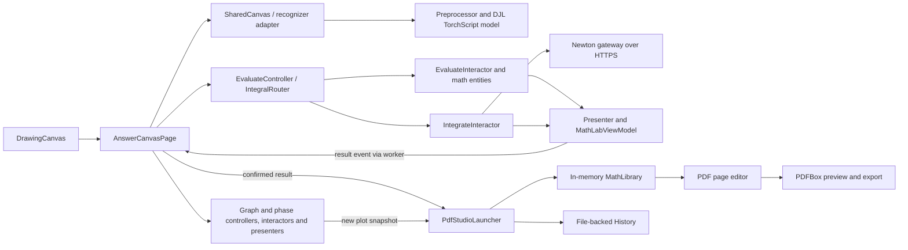
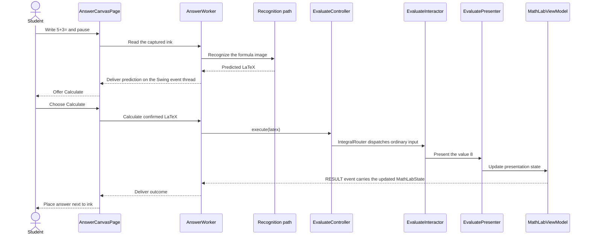

# penTex

penTex is a Java desktop math notebook for students who work problems by hand. Write a formula on the canvas, inspect the predicted LaTeX, then calculate an answer, graph a relation or explore a differential equation. The result stays beside the work that produced it. A History panel and an A4 page editor let a student reuse that work in a PDF without retyping it. The application window is titled **Math Lab**.

[Use cases and requirements](docs/USE_CASES.md) · [Architecture and file inventory](docs/CODEBASE_AUDIT.md) · [Individual contributions and Git evidence](docs/CONTRIBUTIONS.md)

## Run the desktop app

Use JDK 17 or newer, Maven and a graphical desktop. This checkout compiles with Java release 17. The audit used OpenJDK 21 and Maven 3.9.11. On a fresh machine Maven needs access to Maven Central, and DJL needs a compatible PyTorch native runtime. DJL can download the native libraries on first use. The cloud setup supplies a matching Linux CPU runtime from Maven Central. Python and model training are optional for desktop users. [Build configuration](pom.xml) · [Model bootstrap](src/main/java/model/ModelRuntime.java)

Clone the repository if needed, then run from its root. The entry point resolves the model and tokenizer relative to the checkout.

```shell
git clone https://github.com/ZzzymFr/penTex.git
cd penTex
mvn -v
mvn compile exec:java
```

In the prepared Linux cloud checkout, run `source .runtime/activate` from the repository root before using Maven. When running without a graphical display, `xvfb-run -a mvn compile exec:java` starts the app under a virtual X server. The same environment includes the optional model-development interpreter at `.runtime/python/bin/python`.

**Try a calculation.** Write `5+3=` with the pen and lift it. Inspect the recognition popup. If it reads `5+3=`, click **Calculate** to place **8** beside the formula. If the prediction is wrong, edit the ink and try again. Lasso or box-select the strokes to reopen the interpretation and its available actions. A completed relation such as `x²=4` can offer actions without a trailing equals sign.

**Try a graph.** Write `y=x²`, select it and choose **Graph**. Hover over the curve to read a point. Drag the plot to pan, scroll to zoom, or use the range controls. Open **PDF** to place a graph snapshot on a page. Use **Preview** before exporting.

The image below is a checked-in handwriting sample labelled `5+3=`. The bundled Java recognizer returned that label in the audit. It illustrates the input the model sees. [Validation labels](src/neutral%20network/val/labels.jsonl)


## User stories, MVP and contributors

The course assignment asks the team to describe its domain, stories, MVP leads, entities and Java API use. The team-specific goals and numbering come from the earlier project README. The table pairs those recorded assignments with the behavior at the audited revision. Shared implementation work is identified below and traced to methods and diffs in the contribution map. [Course brief, pp. 1–4](https://q.utoronto.ca/courses/444184/pages/project-readme-and-minimum-viable-product-mvp) · [Team specification](https://github.com/ZzzymFr/penTex/blob/09d6004/README.md) · [Contribution map](docs/CONTRIBUTIONS.md)

| Student goal | Use case and historical lead | Implementation in this checkout |
| --- | --- | --- |
| Enter math in handwriting or from a photograph (US1) | UC1 · Yuanmo (Frank) Zha · MVP | **Partial story.** Canvas ink is grouped, rasterized and decoded locally. A paused stroke or selection can open a formula popup. Photo upload for recognition remains unimplemented. |
| Calculate and reuse expressions (US2) | UC2 · Haoxiang Zhao · MVP | Evaluates supported arithmetic, vectors, sets and logic. Handles user functions, derivatives, limits, sums/products and one-unknown conditions. Standalone integrals use Newton (UC2a). |
| Read results beside the original work (US3) | UC3 · Haoxiang Zhao · MVP | Fits the typeset answer to the handwriting and attaches it to the formula. Editing the ink invalidates the previous result. Invalid and unsupported inputs produce different feedback. |
| Explore a relation visually (US4) | UC4, UC4b · Haoyu Wang · MVP | Live 2D curves and implicit contours, explicit and implicit 3D surfaces, and differential-equation portraits. Cards support exploration. Snapshots can be reused in documents. |
| Publish legible math notes (US5) | UC5 · Bojun (Eric) Yang · MVP | Collect formulas, results, selected ink, captures and graph images. Place and edit material, format text, preview and export A4 pages. Eligible placements contribute copyable LaTeX to an appendix. |
| Resume or reuse earlier work (US6) | UC6, UC7 · Bojun (Eric) Yang · post-MVP | History stores reusable entries on disk. Named canvas saves retain ink, answers, placed artwork and viewport. Reopened graph pictures preserve their appearance. |

**How the work was shared.** Frank's commits introduce training and Java inference. Haoxiang connected recognition to the canvas, implemented local evaluation and answer rendering, and contributed implicit 3D graphing. Haoyu's graph and phase work extends into OCR preprocessing and the Newton integral path. Eric's document, History and workspace work includes the board integration that lets material move between them. A snapshot commit reintroduced code already present on other branches. The detailed attribution follows earlier diffs, moved files and surviving lines, and identifies cases where a personal identity or design responsibility cannot be established. [Team contract](TeamContract.md) · [Commit-level evidence](docs/CONTRIBUTIONS.md)

## Architecture

The application uses Swing at the boundary and plain Java domain objects for much of the mathematics. The composition root creates the model adapter, use cases, presenters, session stores and storage gateways. Recognition and calculation run on a worker. The canvas checks the captured formula's revision before applying asynchronous results. Each live plot card gets its own interaction state. [Entry point](src/main/java/app/Main.java) · [Application wiring](src/main/java/app/StackedAppBuilder.java) · [Worker](src/main/java/view/canvas/AnswerWorker.java)



### One calculation, end to end



### Source map

| Location | Responsibility and useful entry points |
| --- | --- |
| [Main.java](src/main/java/app/Main.java), [app/](src/main/java/app/) | Load the shipped model, open a timestamped log, construct the board on Swing's event thread and release the model when the window closes. |
| [view/](src/main/java/view/), [rendering/](src/main/java/rendering/) | Capture and group strokes, paint answers, host live cards, and coordinate History and the PDF editor. Swing listeners route actions to controllers. |
| [entity/](src/main/java/entity/) | Lexer, parser, expression nodes, values and evaluation contexts. Separate packages implement calculus, symbolic operations, integral parsing, graph geometry and phase-plane sampling. |
| [use_case/](src/main/java/use_case/), [interface_adapter/](src/main/java/interface_adapter/) | Input boundaries and interactors select operations. Presenters convert typed output into view state. Graph and phase exploration reuse a stored plot through session interfaces. |
| [data_access/](src/main/java/data_access/), [model/](src/main/java/model/) | In-memory function and plot stores, OCR image preparation, DJL inference and the HTTP adapter for Newton. The exported model, crop parameters and tokenizer ship in the checkout. |
| [pdf_editor/](src/main/java/pdf_editor/), [history/](src/main/java/history/), [workspace/](src/main/java/workspace/) | Separate domains and gateways for page composition, archival entries and named canvas files. The PDF collector connects completed operations to the library and History. |
| [Java tests](src/test/java/), [Python pipeline](src/neutral%20network/) | JUnit tests and standalone model comparison programs. Python tools prepare datasets, train the model, evaluate predictions and export TorchScript operators for Java. |

**Domain entities.** A `Stroke` owns an ordered list of `InkPoint` samples with x, y and time. `addPoint` records a sample and `getPoints` exposes a read-only list. A `Context` carries the function dictionary, variable bindings, sign choice and a shared evaluation budget. `withVariable` creates a bound context and `spendStep` limits work. A `PdfDocument` owns ordered placements and styled body text per page. Its `Placement` stores position, dimensions, material or note, and layout information. `DocumentEditor` validates edits and checkpoints document state for undo. [Stroke](src/main/java/entity/Stroke.java) · [Context](src/main/java/entity/Context.java) · [PdfDocument](src/main/java/pdf_editor/domain/PdfDocument.java) · [DocumentEditor](src/main/java/pdf_editor/use_case/DocumentEditor.java)

### Integrations and configuration

| Component | How penTex uses it | Operational detail |
| --- | --- | --- |
| [DJL](https://docs.djl.ai/) and PyTorch engine 0.39.0 | Runs the bundled CNN and transformer operators. Java prepares an RGB image and decodes LaTeX with beam width 3. | Device selection probes CUDA, then MPS on macOS, with CPU fallback. Linux CPU inference was exercised. The application requires successful model initialization to open the board. |
| [Newton API](https://github.com/aunyks/newton-api) | A Java HTTP client requests an antiderivative for a standalone integral. The request contains the encoded integrand. For finite bounds the application evaluates the returned primitive at both ends locally. | Keyless HTTPS to `newton.vercel.app`. Request construction, parsed responses and failure handling have automated coverage. The historical team README gives a sample Newton response. In this audit the live Java gateway reported OFFLINE when the cloud proxy denied its tunnel with HTTP 403. |
| [JLaTeXMath 1.0.7](https://github.com/opencollab/jlatexmath) | Typesets math for popups, answers, reusable materials and PDF composition. | Rendering runs locally. |
| [Apache PDFBox 2.0.30](https://pdfbox.apache.org/) | Writes rendered pages and the LaTeX appendix. Preview renders the built PDF so its page sequence follows export. | Users choose the export destination. No TeX executable is required. |

### What persists

| Data | Location and lifetime |
| --- | --- |
| History entries | Files under `.mathlab/history` in Java's user home. Content keys prevent duplicate records. Erasing source ink leaves archived entries available. |
| Named canvases | `.mlcanvas` files under `.mathlab/canvases` in Java's user home. The reader supports older formats. The board attempts to restore the most recent save at startup. |
| Functions and plots | Function definitions used for evaluation and live graph/phase sessions reside in memory. History can retain the formula or snapshot. A restored canvas graph is an image. |
| PDF workspace | The library and editable page arrangement live in memory. Export writes a finished PDF to the selected path. |
| Diagnostic logs | Timestamped `.log` files in `logs/` under the directory from which penTex starts. |

## Tests and verification

From the repository root, run the Java suite with a JDK and Maven.

```shell
mvn test
```

Surefire runs JUnit Jupiter tests of parser and evaluator behavior, graph/phase geometry, presentation and canvas interactions, persistence round trips, PDF output and gateway behavior. Recognition adapter tests can inject a model reader, and Newton gateway tests supply controlled HTTP responses. The Python suite uses standard-library `unittest`. Use a separate Python environment for model work. The root requirements file targets CUDA 12.8 on Windows/Linux (`python -m pip install -r requirement.txt`). For macOS, install `python -m pip install -r "src/neutral network/requirement-mac.txt"`, then add the data and test packages with `python -m pip install scipy lightgbm huggingface_hub pyarrow`. For the prepared CPU cloud environment, use its bundled interpreter. Run the following from the repository root with the selected Python environment active. [Root Python requirements](requirement.txt) · [macOS packages](src/neutral%20network/requirement-mac.txt) · [Dataset tools](src/neutral%20network/DATASETS.md)

```shell
cd "src/neutral network"
python -m unittest discover -s tests -v
```

| Check at revision `bb8806d` | Observed result |
| --- | --- |
| Java suite on Linux with a virtual display | **1,676 passed**, zero failures, errors or skips. |
| Desktop smoke | Opened the Math Lab window through Maven. Real mouse clicks opened History and PDF in a separate UI check. |
| Shipped Java OCR on the checked-in validation manifest | Returned nonempty LaTeX for all 29 images. **16/29 exactly matched** the stored string (55.2%). One error changed `8x+4=20` to `\delta x+4=20`. Another mismatch differed only in exponent braces. This measures literal string agreement on this collection. |
| Python suite on CPU | **95 passed, one failed**, zero skipped. `test_fixtures_still_match_python` requires exact equality for a crop feature. The difference was about 2.22 × 10⁻¹⁶. All 30 checked scale decisions matched. |
| Java/Python parity | The shipped operators differed from references generated from the bundled raw checkpoint. The source hash in the export metadata also differs. Regenerating the export and references from the same migrated state passed 51 model comparisons and 72 decoder comparisons. |

## Limitations and development opportunities

- **Recognition.** Read the predicted formula before using it. Canvas input is available today. The team's photo-input story would need a desktop import action and acceptance tests for photographed expressions.
- **Mathematics.** The grammar, evaluation budget and numerical sampling bound the answers and plots the app can produce. For example, finite sampling may miss a singularity between sample points. Online integration also depends on the Newton service. [Math and integration details](docs/CODEBASE_AUDIT.md)
- **Resuming work.** Canvas saves preserve visual results. Persisting a live plot session or an editable PDF project would require additional serialized state and compatibility tests.
- **Model reproducibility.** Pairing each raw checkpoint with its exported operators, source hash and reference fixtures would make cross-language regression checks reproducible from one checkout.
- **Platform verification.** Windows and macOS are project targets. Native model loading, font metrics, HiDPI input and OS file dialogs on those platforms remain unverified in this Linux audit. [Project platform requirements](AGENTS.md)

## Credits and license

penTex is a CSC207 Software Design team project by Yuanmo Zha, Haoxiang Zhao, Haoyu Wang and Bojun Yang. The project carries the MIT license in the file named `LISCENCE`. The bundled Kalam font has its own Open Font License. Dataset preparation notes describe the separately sourced handwriting corpora used by the training tools. [Project license](LISCENCE) · [Font license](src/main/resources/fonts/OFL.txt) · [Dataset notes](src/neutral%20network/DATASETS.md)
