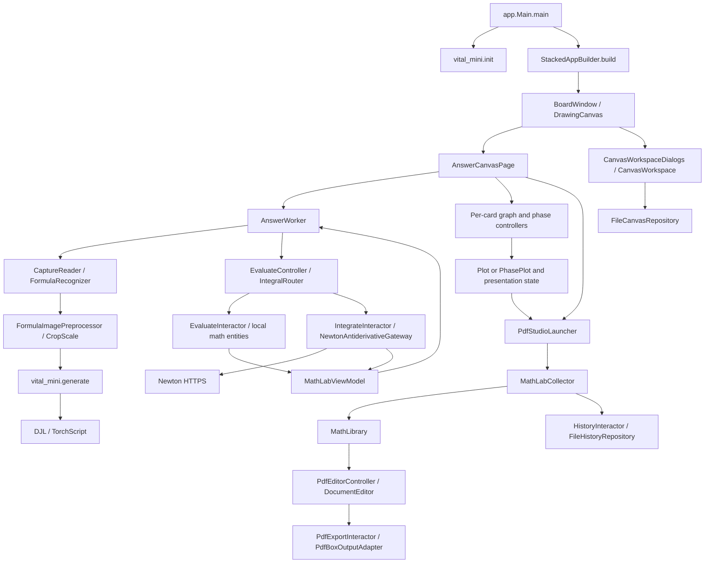

# penTex codebase audit

**Scope.** The source baseline is [bb8806d](https://github.com/ZzzymFr/penTex/commit/bb8806dafd3ffe7170b578db4003ba45f3a781a2). The inventory covers the tracked tree, including model-development tools, local datasets, legacy helpers and test-only entry points. Application behavior is traced from the default Maven main class. See the [use cases](USE_CASES.md) for user-visible status, [contributions](CONTRIBUTIONS.md) for historical evidence and the [README](../README.md) for run instructions and validation results.

| Tree at the audited revision | Tracked files | Coverage |
|---|---:|---|
| Root and `.idea/` | 9 | Build settings, project policy, collaboration records and license |
| `src/main/java/` | 423 | 417 Java compilation units, five model artifacts and one directory placeholder |
| `src/main/resources/` | 3 | Font, its license and one directory placeholder |
| `src/test/java/` | 257 | 255 Java files, one JSON fixture and one directory placeholder |
| `src/neutral network/` | 548 | Python training and tests, documentation, manifests and image collections |
| **Total** | **1,240** | Development caches, compiled classes and runtime user files are outside this baseline |

## Reading guide

- [Runtime paths](#how-the-components-work-together) follow actions across package boundaries.
- [Bootstrap, recognition and infrastructure](#bootstrap-recognition-and-infrastructure) covers wiring, model files and external systems.
- [Math domain and application logic](#math-domain-use-cases-and-interface-adapters) and [desktop, documents and storage](#board-plotting-views-documents-and-local-storage) index every production Java source.
- [Model development and data](#recognition-model-development-and-data) and [Java tests and fixtures](#java-test-and-fixture-index) cover the other source trees.

## How the components work together

Arrows show calls, published results or the path of a user action. The builder supplies implementations for recognition, calculation, graphing, history, editable canvases and PDF gateways. Dependency inversion is particularly visible at the HTTP and storage boundaries. The project also uses direct Swing callbacks and concrete cross-module dependencies. For example, the builder subscribes to graph view models to render PDF snapshots, and `PdfStudioLauncher` constructs its own library, editor and exporter. The desktop is a single Java process. Python training programs share file formats with Java.

### Decision points in the running program

1. **From strokes to LaTeX.** `DrawingCanvas` owns geometry in world coordinates. A capture freezes an image, formula ID and revision. The page uses a worker for recognition and returns its callback to Swing's event dispatch thread. `CaptureReader` can recognize a second image without the handwritten equals when a trailing pair was found and the first result lacked a top-level equals. When the second read yields text it appends the equals. The page checks generation/revision before applying delayed results. Selection, pauses, popup eligibility and explicit user actions determine the next step.
2. **From text to an answer.** The recognition adapter returns text. The local evaluator builds a typed expression tree and dispatches to a presenter, with separate paths for definitions, equation solving and numeric/symbolic results. A standalone integral takes an HTTP-backed path. Presentation includes answer kind, readable text, TeX and error state. The worker delivers a calculation outcome for the page to attach to the originating ink and publish via the result sink. Preview recognition alone has no archive side effect.
3. **From formula to live card.** The builder creates independent graph and phase sessions. Plot creation and exploration share the same session and presenter. New successful state publishes an image to PDF Studio. Pan/zoom change view state and avoid duplicating the archived graph. Saved canvases preserve images and bounds of cards. Restoring a board reconstructs static graph artwork. The interactive session object resided in process memory.
4. **From completed work to documents.** `MathLabCollector` marshals changes to the event thread. For calculations it attempts to persist history before publishing a material to library listeners. For graphs it first creates a library material, then passes its encoded PNG to history. Persistence failures are logged and publication may still succeed in memory. Copies into a `PdfDocument` acquire placement coordinates and their own edit history. The editor renders pages and exports through PDFBox. Clearing board ink leaves archived items available.
5. **From board state to disk.** `CanvasWorkspaceDialogs` and `CanvasWorkspace` coordinate save, Save As and restart selection. `FileCanvasRepository` encodes ink, answer data, assets and viewport into versioned files under the user's home. History storage has a separate format and lifecycle. Editable PDF placements, the local user-function map and live plot sessions do not share either repository. A PDF export produces a finished file.

**Core patterns.** `NodeVisitor`, `ValueVisitor` and `PlotVisitor` dispatch by math/plot type. Formula capture revisions address stale asynchronous results. View models publish property changes to separate fresh artifacts, view changes and calculation results. Function, graph and phase stores implement narrow use-case interfaces. The editor's snapshots support undo/redo. The board canvas uses the Command pattern: drawing, erasing, Clear, selection edits, picture edits, zoom and Reset view are `Command` objects run through one `CommandHistory` ([use_case/command](../src/main/java/use_case/command/), [interface_adapter/canvas](../src/main/java/interface_adapter/canvas/)). Content commands keep a canvas memento, view commands keep the replaced `ViewportState`, and the notches of one zoom gesture merge into one step. Swing event handlers and layout, input hit-testing and rendering state occupy much of the project. Tests for those areas often exercise actual component geometry and event dispatch.

## Bootstrap, recognition and infrastructure

Paths in the following source tables are under `src/main/java`. The live recognition path preserves source RGB, estimates the background from border samples and crops foreground whose color differs from the chosen background. The production canvas supplies dark strokes on white. The trained crop-scale model adjusts the dominant band before `FormulaLayout` selects stride-aligned dimensions. The alternative grayscale and fixed-width helpers are separately testable.

| File | Responsibility, inputs, outputs and connections |
|---|---|
| [app/Main.java](../src/main/java/app/Main.java) | Entry point (`app.Main`, the Maven main class). `main` constructs the model and calls `init` before scheduling `run`. Startup creates a timestamped log, initializes native inference, installs the system look and feel when available, builds the frame on Swing's event thread and shows it. The window-closed callback releases the model. An initialization exception handled in main closes it and exits with status 1. |
| [app/StackedAppBuilder.java](../src/main/java/app/StackedAppBuilder.java) | Composition root. `build` wires use cases, data adapters and view models, routes integrals, supplies a session factory per card, embeds PDF and history, and binds shortcuts and close confirmation. A second `MathLabViewModel` isolates history recalculation from the board's pending result. Both evaluators share the function store. Startup calls `restoreLatestAtStartup`. |
| [app/LogWriter.java](../src/main/java/app/LogWriter.java) | Creates missing parent directories, appends `.log` if necessary, opens a Java logging `FileHandler` in append mode and exposes level/exception overloads plus `close`. `app.init` logs startup and successful model initialization. |
| [data_access/BandRule.java](../src/main/java/data_access/BandRule.java) | Injectable line-height rule with tallest-band or whole-ink implementations. The optional grayscale overload of `prepare` consumes it. |
| [data_access/CropScale.java](../src/main/java/data_access/CropScale.java) | Lazily loads and validates the scale model, computes occupancy, band statistics, component boxes, row-run and shear features from the cropped mask. `chooseIndex` predicts a candidate multiplier using direct or surface trees. `RULE` gives a constant 1. Missing deployment file raises an unchecked I/O error. |
| [data_access/FormulaImagePreprocessor.java](../src/main/java/data_access/FormulaImagePreprocessor.java) | `prepare(image)` composites alpha on white, finds the foreground, sizes it using `CropScale` and `FormulaLayout`, and centers resized RGB on black/white padding. Empty ink raises an argument error. The overload accepting `BandRule` estimates pen thickness and uses grayscale. |
| [data_access/FormulaLayout.java](../src/main/java/data_access/FormulaLayout.java) | `rowSpans` and `tallestBand` group occupied rows. `size` computes scale and dimensions with a nominal 112-pixel band, 8-pixel margins, 16-pixel stride and minimum 64 × 128 canvas. It shrinks until height is at most 512 and the feature grid has at most 1,280 cells. |
| [data_access/GrayInk.java](../src/main/java/data_access/GrayInk.java) | `of` produces dark-on-white grayscale from ARGB. Bounds, per-row flags, a crop and median pen runs feed the alternative preprocessor and width limiter. |
| [data_access/InMemoryFunctionDataAccessObject.java](../src/main/java/data_access/InMemoryFunctionDataAccessObject.java) | `saveFunction` puts a `UserFunction` in a name-keyed map. `getAllFunctions` supplies a map copy. This is the process-local definition context for board and history evaluation. |
| [data_access/InMemoryGraphSessionDataAccessObject.java](../src/main/java/data_access/InMemoryGraphSessionDataAccessObject.java) | Synchronized `save`/`current` store one `Plot` for graph creation and exploration inside a card. |
| [data_access/InMemoryPhaseSessionDataAccessObject.java](../src/main/java/data_access/InMemoryPhaseSessionDataAccessObject.java) | Synchronized `save`/`current` store one `PhasePlot` shared by creation and exploration of a portrait. |
| [data_access/ReadableWidth.java](../src/main/java/data_access/ReadableWidth.java) | `fit` can crop and shrink a wide input to a 576-pixel target subject to a 32-pixel minimum ink height. The recognizer calls the preprocessor directly. The long-line test checks the width of the actual adapter input. |
| [data_access/VitalMiniFormulaRecognizer.java](../src/main/java/data_access/VitalMiniFormulaRecognizer.java) | Implements the image-to-text `FormulaRecognizer` port. `recognize` passes prepared pixels to `model.generate(prepared, 3)`. A package-private `ModelReader` constructor allows tests to capture model input and return controlled text. |
| [data_access/newton/NewtonHttp.java](../src/main/java/data_access/newton/NewtonHttp.java) | Transport seam with `get(URI)` and a status/body response record. Enables offline gateway tests. |
| [data_access/newton/JdkNewtonHttp.java](../src/main/java/data_access/newton/JdkNewtonHttp.java) | Synchronous JDK HTTP GET with normal redirects, 5-second connect and 15-second request timeouts. Returns status and response text. |
| [data_access/newton/NewtonAntiderivativeGateway.java](../src/main/java/data_access/newton/NewtonAntiderivativeGateway.java) | `find` converts and URL-encodes the integrand, calls Newton's `/api/v2/integrate/` endpoint and extracts its JSON result string. Transport/interruption and invalid/non-200 results become typed failures. No API key is supplied. |
| [data_access/newton/NewtonQueryWriter.java](../src/main/java/data_access/newton/NewtonQueryWriter.java) | Recursively rewrites token groups, fractions, trig calls and log bases into Newton notation. `expression` substitutes the variable with x for the request. |
| [data_access/newton/NewtonResultReader.java](../src/main/java/data_access/newton/NewtonResultReader.java) | `read` tokenizes the response and parses expression precedence and calls to produce `Antiderivative` containing LaTeX and plain text, restoring the original variable. Rejects unsupported syntax and leftover input. |
| [model/InferenceDevice.java](../src/main/java/model/InferenceDevice.java) | `automatic` probes CUDA when reported and MPS on macOS, using tensor allocation and arithmetic. Falls back to CPU. The PyTorch engine itself must load on every device. |
| [model/ModelRuntime.java](../src/main/java/model/ModelRuntime.java) | Opens one TorchScript module and DJL predictor with a scoped tensor manager. Dispatches an allowlisted named module method through an `NDList` marker, checks output cardinality and closes native resources. An existing `.runtime/djl` is used if no engine-cache override exists. |
| [model/vital_pixel.java](../src/main/java/model/vital_pixel.java) | Validates float input shape [batch, 3, H, W] and stride divisibility, invokes the exported CNN and returns its feature map. Tracks whether it owns the runtime or shares one with `vital_mini`. |
| [model/encoder.java](../src/main/java/model/encoder.java) | Validates a sequence with 256-dimensional features and optional padding mask. Dispatches either exported visual encoder block. Supports both shared and independently owned runtimes. |
| [model/decoder.java](../src/main/java/model/decoder.java) | Standalone wrapper for a named decoder block or judge decoder. Validates hidden sequence, memory and masks, transfers input as needed, and returns hidden features. Used by parity tooling. Normal generation calls incremental decoding via `ModelRuntime`. |
| [model/vital_mini.java](../src/main/java/model/vital_mini.java) | `init` reads token embeddings from the tied head, verifies 234 × 256 shape and probes the two encoders and incremental decoder entry points. `generate` normalizes image pixels, runs the CNN and encoders once, decodes cached steps and maps winning IDs through the vocabulary. `forward`, `decode` and `judge` support direct tensor use. |
| [model/BeamSearch.java](../src/main/java/model/BeamSearch.java) | `advance` scores next-token hypotheses, masks BOS/PAD after log-softmax, tracks parent beams and ranks completed sequences with length exponent 0.7. `best` falls back to the highest-ranked live sequence at the length limit. Generation uses a maximum sequence length of 300. |
| [rendering/TransparentArtwork.java](../src/main/java/rendering/TransparentArtwork.java) | `removeWhiteMatte` handles a fully opaque raster with at least 80% near-white border samples. It recovers alpha/color from white-backed ink. Images with any existing transparency or unsuitable borders are returned as supplied. Used for chart artwork in presentations. |

### Deployment artifacts, configuration and credits

| Path | What the application or developer uses |
|---|---|
| [pom.xml](../pom.xml) | Maven's Java 17 release, UTF-8 compilation, `app` entry point and Surefire runner. Direct dependencies are DJL API/PyTorch engine 0.39.0, PDFBox 2.0.30, JLaTeXMath 1.0.7 and JUnit Jupiter 5.10.2 for tests. Gson is used through the dependency tree. Model files are read from the checkout relative to its working directory. |
| [model_ops.pt](../src/main/java/model/checkpoints/model_ops.pt) | Shipped TorchScript export loaded by the desktop. The archive contains serialized module code and tensors. Its methods include CNN, encoder/decoder layers and cached decoding. |
| [model.pt](../src/main/java/model/checkpoints/model.pt) | Separate PyTorch checkpoint archive. Its SHA-256 is `293e655a7986edd06dee0e97cc1407d08fabfa5b4fe3a8b656a7eddf7fb50048`. |
| [model_ops.json](../src/main/java/model/checkpoints/model_ops.json) | Export manifest records architecture, Torch version and checkpoint hash `268c64e36dec6349a354e8fb7c9d26f494e03e2d1b3060decc0c701175b90025`. The differing hashes leave exact reproduction of the shipped export from the accompanying training checkpoint unverified. |
| [crop_scale.json](../src/main/java/model/checkpoints/crop_scale.json) | Direct-mode crop predictor with 48 named input features, 300 trees and 15 candidate scales. The current artifact's digest matches the digest stored in the Java test fixture. |
| [tokeniser.json](../src/main/java/model/checkpoints/tokeniser.json) | Deployment vocabulary. `vital_mini.generate` reads the 234 ID mappings, rejects duplicate/out-of-range IDs, omits special IDs and inserts separating spaces after command names when needed. |
| [Kalam-Regular.ttf](../src/main/resources/fonts/Kalam-Regular.ttf) and [OFL.txt](../src/main/resources/fonts/OFL.txt) | Bundled handwriting face loaded by `AnswerFont` through the classpath. It falls back to an installed UI font for unsupported glyphs. Indian Type Foundry's SIL Open Font License 1.1 accompanies it. |
| [AGENTS.md](../AGENTS.md) and [CLAUDE.md](../CLAUDE.md) | Contributor rules for Java 17/Maven, cross-platform Windows/macOS Swing behavior, paths, fonts and verification. The second file points to the first. These express project policy. Platform parity requires runtime measurements. |
| [TeamContract.md](../TeamContract.md) | Team signatures and collaboration expectations (WeChat, response time, conflict resolution and responsibility). It also retains template prompts. It does not establish who implemented a method. |
| [LISCENCE](../LISCENCE) | Repository MIT license under its actual filename. The font uses the SIL Open Font License. Dataset documentation identifies external data sources. |
| [README.md](../README.md) | At the audited revision this contained only the name penTex. The current guide was produced from this audit and the supplied course materials. |
| [requirement.txt](../requirement.txt) | Python model-development dependencies with a CUDA Torch build for Windows/Linux and a reference to macOS requirements. Separate from Java runtime dependencies. |
| [.gitignore](../.gitignore) and [.idea/.gitignore](../.idea/.gitignore) | Exclude build and tool output, runtime caches, logs, Python environments and local IDE metadata. Empty `.gitkeep` entries in the Java, test, resources and training trees preserve directory structure. |

## Math domain, use cases and interface adapters

A calculation enters through `EvaluateController.execute`. The application builder injects an `IntegralRouter`, an in-memory function store and a presenter. A local calculation tokenizes the expression, parses a typed AST and inspects its free variables. It can evaluate a value, register a function definition, return a symbolic derivative or approximate a one-variable solution set. The presenters retain both a human-readable answer and typeset LaTeX. Standalone integrals take a separate gateway path. A supported integrand with finite bounds is probed at 401 equally spaced positions before the returned primitive is evaluated at the endpoints. This test can miss a singularity between samples. If local parsing of the integrand fails, the bound evaluator skips this probe and proceeds to evaluate the supplied primitive.

Graph and phase cards each receive a fresh session from the builder. Creating a graph selects an explicit or implicit function representation, samples geometry and stores the plot behind a session port. Exploration creates new viewport or seed state inside that session and publishes fresh geometry. Cursor traces and find results have separate presentation callbacks. The builder subscribes to new successful graph/phase state and captures a raster for PDF Studio. Pan, zoom and trace events take a separate event path.

The following packages are rooted at `src/main/java`. Method names identify points to inspect in each source file.

### `entity/`

| Source | Implementation and connections | Methods |
| --- | --- | --- |
| [BudgetExceededException.java](../src/main/java/entity/BudgetExceededException.java) | Signals the shared evaluation step limit with the TOO_MUCH_WORK reason. | Type declaration |
| [ComparisonFinder.java](../src/main/java/entity/ComparisonFinder.java) | Inspects relation operands to construct numeric comparisons for scalar values, vector components and finite-set element pairs. Splits products compared with zero to expose roots. | `numericPairs`, `addFactorPairs` |
| [ConditionRoots.java](../src/main/java/entity/ConditionRoots.java) | Collects candidate boundaries from ordinary and membership relations, keeps scan reliability flags, and proposes probes between roots. | `all`, `addRoots` |
| [ConditionSolver.java](../src/main/java/entity/ConditionSolver.java) | Converts one-variable conditions to intervals using truth samples, comparison roots and checks beyond the dense search window. Quantifier searches specialize the probing for real, rational and integer domains. | `solve`, `containsQuantifier` |
| [Context.java](../src/main/java/entity/Context.java) | Carries function definitions, scoped numeric bindings, sign choices and a derivative strategy. Child contexts share a step budget and a cache keyed by AST identity, free-variable values and signs. | `find`, `withVariable` |
| [EquationDisplay.java](../src/main/java/entity/EquationDisplay.java) | Normalizes redundant equals signs, sizes matrix delimiters and chooses equality or implication when History, Library and PDF display formula/result pairs. | `typeset`, `formula` |
| [EquationSolver.java](../src/main/java/entity/EquationSolver.java) | Searches numeric side differences for sign changes and touching roots. Refines candidates by bisection or local minimization and checks equality and sampling reliability before accepting results. | `solve`, `partOf` |
| [FarBoundaries.java](../src/main/java/entity/FarBoundaries.java) | Checks candidate roots outside the central search region against observed truth changes before extending solution intervals. | `pastRange`, `genuine` |
| [ImplicitCurve.java](../src/main/java/entity/ImplicitCurve.java) | Holds source LaTeX and a two-variable signed difference whose zeros define a planar contour. | `evaluate`, `getLatex` |
| [ImplicitCurveReader.java](../src/main/java/entity/ImplicitCurveReader.java) | Requires one equality with precisely x and y free. Parses both sides through the calculator and exposes their numeric difference to contour tracing. | `parse`, `read` |
| [ImplicitSurface.java](../src/main/java/entity/ImplicitSurface.java) | Carries the three-variable scalar field and original LaTeX used to sample an implicit surface. | `evaluate`, `getLatex` |
| [ImplicitSurfaceReader.java](../src/main/java/entity/ImplicitSurfaceReader.java) | Requires one equality with precisely x, y and z free. Builds an evaluator for left side minus right side using calculator nodes. | `parse`, `read` |
| [InkEditor.java](../src/main/java/entity/InkEditor.java) | Builds replacement strokes when erasing along a path, translating or scaling. Lasso hit tests and whole-stroke removal operate on sampled pixel coordinates. | `erase`, `eraseAlong` |
| [InkPoint.java](../src/main/java/entity/InkPoint.java) | Stores the canvas pixel coordinates and millisecond timestamp of one pen sample. | `getX`, `getY` |
| [Interval.java](../src/main/java/entity/Interval.java) | Carries numeric endpoints and their inclusion flags. Point detection accounts for relative and absolute endpoint distance. | `getLow`, `isLowIncluded` |
| [LatexFunctionParser.java](../src/main/java/entity/LatexFunctionParser.java) | Parses explicit scalar curves, explicit surfaces and two-variable ODE field components into callable real functions. Handles implicit multiplication, roots, fractions, powers and supported named functions. | `parse`, `parseSurface` |
| [LatexParseException.java](../src/main/java/entity/LatexParseException.java) | Carries a graph or differential-equation parsing diagnostic to the corresponding interactor. | Type declaration |
| [MathException.java](../src/main/java/entity/MathException.java) | Base runtime exception for malformed and unevaluable calculator input. | Type declaration |
| [MathFunction.java](../src/main/java/entity/MathFunction.java) | Pairs the displayed LaTeX with a one-variable numeric rule for explicit graph evaluation. | `evaluate`, `getLatex` |
| [MathLexer.java](../src/main/java/entity/MathLexer.java) | Tokenizes recognized LaTeX and normalizes Unicode symbols, command aliases, Greek letters and prime notation before calculator parsing. | `tokenize`, `foldPrimes` |
| [MathParser.java](../src/main/java/entity/MathParser.java) | Recursive-descent parser producing Node trees with scoped names, operator precedence, comparison chains, quantifiers, function calls and calculus constructs. Tracks independent plus/minus signs. | `parse`, `namedFunctions` |
| [MathSyntaxException.java](../src/main/java/entity/MathSyntaxException.java) | Carries a SyntaxProblem and detail arguments through the calculator boundary for later formatting. | `getProblem`, `getDetails` |
| [OverflowException.java](../src/main/java/entity/OverflowException.java) | Signals a numeric overflow that prevents a reliable comparison. | Type declaration |
| [RoundingCheck.java](../src/main/java/entity/RoundingCheck.java) | Probes rounding scale and side magnitudes to decide whether an apparent change of truth could be floating-point noise. | `reliabilityAt`, `numberAt` |
| [SampleTruth.java](../src/main/java/entity/SampleTruth.java) | Evaluates a condition with a bound trial variable and shared budget. Tracks uncertain samples caused by rounding and fills qualifying runs for interval construction. | `truthAt`, `withRoundingRunsFilled` |
| [SearchPoints.java](../src/main/java/entity/SearchPoints.java) | Builds candidate sets for truth search, including nearby integers, root neighborhoods, far gaps and values already bound in the context. | `integerPoints`, `cheapPoints` |
| [SidePair.java](../src/main/java/entity/SidePair.java) | Evaluates a selected component or whole value on each comparison side and computes their difference while retaining approximation information. | `leftAt`, `rightAt` |
| [SideScan.java](../src/main/java/entity/SideScan.java) | Samples side differences beyond the dense window. Refines crossings and checks potential roots, domain edges and shallow minima. | `scanValue`, `difference` |
| [Stroke.java](../src/main/java/entity/Stroke.java) | Accumulates InkPoint samples for one pen-down/pen-up path and exposes an unmodifiable view of the points. | `addPoint`, `getPoints` |
| [SurfaceFunction.java](../src/main/java/entity/SurfaceFunction.java) | Wraps the explicit z(x,y) rule and its source LaTeX for grid sampling. | `evaluate`, `getLatex` |
| [SyntaxProblem.java](../src/main/java/entity/SyntaxProblem.java) | Defines machine-readable parse failures including missing operands, unknown names, invalid functions and delimiter errors. | Type declaration |
| [TruthSearch.java](../src/main/java/entity/TruthSearch.java) | Tests existential or universal conditions with sample points, candidate roots and far probes. Supplies verdicts to ConditionSolver's quantified searches. | `find`, `noMemberGives` |
| [UncalculableException.java](../src/main/java/entity/UncalculableException.java) | Represents a syntactically recognizable expression the evaluator cannot resolve, with optional reason and detail. | `getReason`, `getDetail` |
| [UncalculableReason.java](../src/main/java/entity/UncalculableReason.java) | Defines evaluation failure categories for unsupported operations, excessive work, indeterminate outcomes, range and domain errors. | Type declaration |
| [UndecidableException.java](../src/main/java/entity/UndecidableException.java) | Carries UNDECIDED or a specific indeterminacy reason through numeric comparison and condition search. | Type declaration |
| [UndefinedException.java](../src/main/java/entity/UndefinedException.java) | Identifies an undefined value at a trial point so domain-sensitive evaluation can handle it appropriately. | Type declaration |
| [UserFunction.java](../src/main/java/entity/UserFunction.java) | Keeps the function name, formal parameters, parsed body and original body text for use by later calculator calls. | `getName`, `getParameters` |

### `entity/calculus/`

| Source | Implementation and connections | Methods |
| --- | --- | --- |
| [DerivativeCalculator.java](../src/main/java/entity/calculus/DerivativeCalculator.java) | Uses numerical differences and extrapolation with error estimates and one-sided checks. Rejects orders outside 1–4 and unreliable estimates. | `derivative`, `derivativeWithError` |
| [FarLimit.java](../src/main/java/entity/calculus/FarLimit.java) | Extends large-magnitude probes toward floating-point range limits and checks whether the tail settles or grows consistently. | `canGoFrom`, `limit` |
| [LimitCalculator.java](../src/main/java/entity/calculus/LimitCalculator.java) | Combines one-sided finite or infinite-point samples, detects oscillation, growth and rounding plateaus, and rejects incompatible or unreliable side limits. | `limit`, `unlessLost` |
| [LimitSide.java](../src/main/java/entity/calculus/LimitSide.java) | Represents a side of the approach as a value function with noise and absorption probes used by LimitCalculator. | `valueAt`, `noiseAt` |
| [Rounding.java](../src/main/java/entity/calculus/Rounding.java) | Rounds a finite double to the requested significant digits for approximate output. | `toSignificant` |
| [SeriesCalculator.java](../src/main/java/entity/calculus/SeriesCalculator.java) | Accumulates bounded sums/products and tests infinite tails using extrapolation and convergence checks. Caps the size of finite ranges. | `series`, `wynn` |

### `entity/graph/`

| Source | Implementation and connections | Methods |
| --- | --- | --- |
| [AutoBox.java](../src/main/java/entity/graph/AutoBox.java) | Fits an implicit surface inside a 3D sampling box, refining closed surfaces while checking for contacts with the box walls. | `within`, `around` |
| [AutoRange.java](../src/main/java/entity/graph/AutoRange.java) | Filters finite samples and pads a window around their range. Uses central percentiles to reduce the effect of extreme outliers. | `window` |
| [ContourTracer.java](../src/main/java/entity/graph/ContourTracer.java) | Uses marching squares to trace grid-cell sign changes of F(x,y), then links crossings into drawable polylines. | `trace`, `cell` |
| [Curve.java](../src/main/java/entity/graph/Curve.java) | Carries sampled polyline pieces as x/y arrays. Separate pieces let the renderer leave gaps at detected discontinuities. | `getPieces`, `isEmpty` |
| [CurvePlot.java](../src/main/java/entity/graph/CurvePlot.java) | Owns one or more explicit functions in a window, caches sampled curves and key points, and resolves cursor traces on an active layer. | `accept`, `lookingAt` |
| [CurveSampler.java](../src/main/java/entity/graph/CurveSampler.java) | Walks an explicit function across the viewport and splits the line at holes or discontinuities. | `sample`, `flush` |
| [ImplicitCurvePlot.java](../src/main/java/entity/graph/ImplicitCurvePlot.java) | Samples an implicit curve with ContourTracer and finds a nearby point on the sampled contour for cursor tracing. | `accept`, `lookingAt` |
| [ImplicitPlot.java](../src/main/java/entity/graph/ImplicitPlot.java) | Stores an implicit surface, floor and height limits. Computes mesh geometry and searches for a surface point for tracing. | `accept`, `lookingAt` |
| [KeyPoint.java](../src/main/java/entity/graph/KeyPoint.java) | Identifies a sampled root, extremum or intercept by kind and coordinates for annotation and snapping. | `toString`, `getX` |
| [KeyPointFinder.java](../src/main/java/entity/graph/KeyPointFinder.java) | Searches explicit curves within the viewport for roots, turns and y-intercepts using bisection/refinement, capping and deduplicating markers. | `find`, `addCapped` |
| [LookupQuery.java](../src/main/java/entity/graph/LookupQuery.java) | Parses text in axis boxes into numeric coordinates and blanks. Records which input failed when a value cannot be evaluated. | `read`, `of` |
| [LookupResult.java](../src/main/java/entity/graph/LookupResult.java) | Stores matching layer-indexed points, slice paths and lookup status including visibility, truncation and input problems. | `Point`, `Path` |
| [Plot.java](../src/main/java/entity/graph/Plot.java) | Common graph session interface for source LaTeX, home/current windows, replacement viewport, tracing and visitor dispatch. | `accept`, `join` |
| [PlotLookup.java](../src/main/java/entity/graph/PlotLookup.java) | Plot visitor for coordinate queries. Evaluates explicit functions directly where possible and searches the viewport for intersections and constant-coordinate slices. | `point`, `done` |
| [PlotVisitor.java](../src/main/java/entity/graph/PlotVisitor.java) | Dispatch interface for explicit curves, explicit surfaces, implicit contours and implicit surfaces. | `visitCurve`, `visitSurface` |
| [RootScan.java](../src/main/java/entity/graph/RootScan.java) | Samples one-dimensional graph lookup functions, refines crossings and touching minima, and excludes discontinuities from candidates. | `roots`, `touches` |
| [SurfaceGrid.java](../src/main/java/entity/graph/SurfaceGrid.java) | Evaluates z=f(x,y) over an evenly spaced floor grid. Stores missing values as NaN and tracks usable z bounds. | `sample`, `size` |
| [SurfaceMesh.java](../src/main/java/entity/graph/SurfaceMesh.java) | Groups quads in world coordinates for rendering and derives their bounds for automatic framing. | `size`, `bounds` |
| [SurfaceNets.java](../src/main/java/entity/graph/SurfaceNets.java) | Samples a 3D signed field, computes a vertex per crossed cell, and builds clipped quads around sign-changing edges at the box walls. | `mesh`, `axis` |
| [SurfacePlot.java](../src/main/java/entity/graph/SurfacePlot.java) | Maintains explicit surface layers and their sampled grids, calculates shared z limits, clips to supplied heights and traces individual layers. | `accept`, `lookingAt` |
| [TracePoint.java](../src/main/java/entity/graph/TracePoint.java) | Represents a 2D or 3D world coordinate under the cursor with optional point classification. | `onCurve`, `onSurface` |
| [Viewport.java](../src/main/java/entity/graph/Viewport.java) | Validates finite ordered axis limits and produces new clamped zoom/pan windows for graph and phase sessions. | `width`, `height` |

### `entity/integral/`

| Source | Implementation and connections | Methods |
| --- | --- | --- |
| [DefiniteIntegral.java](../src/main/java/entity/integral/DefiniteIntegral.java) | Parses numeric bounds, samples 401 integrand values when locally parseable, and evaluates the supplied primitive at both endpoints. Undefined samples fail the calculation. | `parse`, `bound` |
| [Integral.java](../src/main/java/entity/integral/Integral.java) | Represents a nonempty integrand token list, variable of integration and optional pair of bounds. | `getIntegrand`, `getVariable` |
| [IntegralParser.java](../src/main/java/entity/integral/IntegralParser.java) | Splits a standalone integral into integrand, differential and optional bounds. Handles grouped limits, upright differential notation and trailing equals. | `parse`, `endsWithEquals` |

### `entity/node/`

| Source | Implementation and connections | Methods |
| --- | --- | --- |
| [BinaryNode.java](../src/main/java/entity/node/BinaryNode.java) | Evaluates arithmetic, logical and set operations, and dispatches vector operations by operand types. Records absorbed numeric terms in the evaluation context. | `evaluate`, `accept` |
| [CallNode.java](../src/main/java/entity/node/CallNode.java) | Checks arity and resolves a saved user-defined function, binds evaluated arguments in a new function scope, and delegates derivative calls through the context strategy. | `evaluate`, `accept` |
| [DerivativeNode.java](../src/main/java/entity/node/DerivativeNode.java) | Evaluates the requested derivative in context, handles partials and free variables, and records approximation error. | `evaluate`, `accept` |
| [ExactPowers.java](../src/main/java/entity/node/ExactPowers.java) | Computes integral powers and exact rational roots of reduced fractions with checked arithmetic. | `power`, `root` |
| [FallbackDerivative.java](../src/main/java/entity/node/FallbackDerivative.java) | Tries a preferred PointDerivative and uses a secondary implementation when needed. | `at`, `isExact` |
| [FunctionNode.java](../src/main/java/entity/node/FunctionNode.java) | Evaluates an argument and optional extra argument, then applies the corresponding built-in NamedFunction. | `evaluate`, `accept` |
| [LimitNode.java](../src/main/java/entity/node/LimitNode.java) | Binds the approach variable, evaluates the target and body, and supplies side/value/noise probes to LimitCalculator. | `evaluate`, `accept` |
| [LiteralNode.java](../src/main/java/entity/node/LiteralNode.java) | Returns a preconstructed Value directly, preserving its condition and infinity properties for parent expressions. | `evaluate`, `accept` |
| [Membership.java](../src/main/java/entity/node/Membership.java) | Checks scalar/vector membership and subset relations over finite sets and standard number sets. Uses exact shape information when a typed element is available. | `containsNumber`, `containsWritten` |
| [NamedFunction.java](../src/main/java/entity/node/NamedFunction.java) | Registry of built-in functions, their supported argument syntax, evaluation rules and propagated floating-point noise. | `of`, `apply` |
| [Node.java](../src/main/java/entity/node/Node.java) | Abstract AST contract for evaluation and visitor dispatch. Default recursive operations collect free variables and inspect derivative, approximation and infinity properties. | `evaluate`, `accept` |
| [NodeVisitor.java](../src/main/java/entity/node/NodeVisitor.java) | Typed dispatch for each AST node variant, used by symbolic and structure-sensitive operations. | `visitBinary`, `visitCall` |
| [NoiseScale.java](../src/main/java/entity/node/NoiseScale.java) | Estimates floating-point error through supported numeric AST operations and built-in functions for use in comparisons. | `noiseOf`, `of` |
| [NoiseTolerance.java](../src/main/java/entity/node/NoiseTolerance.java) | Combines operand noise estimates and scale to test numeric closeness and select comparison tolerance. | `of`, `within` |
| [NumberNode.java](../src/main/java/entity/node/NumberNode.java) | Wraps a numeric literal with its decimal precision metadata for evaluation, presentation and rationality checks. | `evaluate`, `accept` |
| [NumericDerivative.java](../src/main/java/entity/node/NumericDerivative.java) | Adapts repeated AST sampling with a bound variable to the Ridders-style numerical derivative calculator. | `at`, `isExact` |
| [PlusMinusNode.java](../src/main/java/entity/node/PlusMinusNode.java) | Selects a sum or difference for the indexed sign bit of the current evaluation, including vector cases. | `evaluate`, `accept` |
| [PointDerivative.java](../src/main/java/entity/node/PointDerivative.java) | Strategy contract for evaluating a derivative at bound coordinates and reporting whether an exact method applies. | `at`, `isExact` |
| [QuantifierNode.java](../src/main/java/entity/node/QuantifierNode.java) | Binds the quantified variable inside the body and chooses finite-domain enumeration or ConditionSolver search by domain and quantifier. | `evaluate`, `accept` |
| [Rationality.java](../src/main/java/entity/node/Rationality.java) | Represents an exact fraction, established irrationality or an unknown result for membership decisions. | `exact`, `isExact` |
| [RationalityCheck.java](../src/main/java/entity/node/RationalityCheck.java) | AST visitor inferring rationality from literals and supported operations using Rational and ExactPowers. | `of`, `factorial` |
| [RelationNode.java](../src/main/java/entity/node/RelationNode.java) | Evaluates comparison chains, equality, membership and geometric relations with type checks and rounding tolerances. | `evaluate`, `accept` |
| [SeriesNode.java](../src/main/java/entity/node/SeriesNode.java) | Binds an iteration variable and evaluates the bounds and term of a sum or product through SeriesCalculator. | `evaluate`, `accept` |
| [SetLiteralNode.java](../src/main/java/entity/node/SetLiteralNode.java) | Evaluates each child as a finite real number and constructs a deduplicated FiniteSetValue. | `evaluate`, `accept` |
| [SignedNumber.java](../src/main/java/entity/node/SignedNumber.java) | Recognizes a numeric literal with optional unary negation and recovers its written decimal precision. | `decimalsOf`, `is` |
| [UnaryNode.java](../src/main/java/entity/node/UnaryNode.java) | Implements negation, logical NOT, factorial, percent, absolute value, norm and unit-vector operations with value-specific checks. | `evaluate`, `accept` |
| [VariableNode.java](../src/main/java/entity/node/VariableNode.java) | Resolves one named binding from Context and adds its name during free-variable collection. | `evaluate`, `accept` |
| [VectorNode.java](../src/main/java/entity/node/VectorNode.java) | Evaluates component expressions to finite numbers and preserves their order in a VectorValue. | `evaluate`, `accept` |
| [WrittenElements.java](../src/main/java/entity/node/WrittenElements.java) | Visitor that extracts the original AST element expressions from a set literal for structural comparisons. | `visitSetLiteral`, `visitBinary` |

### `entity/phase/`

| Source | Implementation and connections | Methods |
| --- | --- | --- |
| [ArrowField.java](../src/main/java/entity/phase/ArrowField.java) | Samples a DifferentialEquation on a viewport grid and stores coordinates and direction components, leaving undefined arrows as NaN. | `sample`, `size` |
| [DifferentialEquation.java](../src/main/java/entity/phase/DifferentialEquation.java) | Represents either a slope field or phase plane with named axes, original notation and two evaluable field components. | `dh`, `dv` |
| [DifferentialEquationParser.java](../src/main/java/entity/phase/DifferentialEquationParser.java) | Translates a first-order scalar ODE, supported autonomous second-order equation or two-equation system into a plane field. Recognizes prime, dot and differential-fraction forms. | `parse`, `at` |
| [Equilibrium.java](../src/main/java/entity/phase/Equilibrium.java) | Represents an isolated stationary point or horizontal equilibrium line with stability classification. | `line`, `isLine` |
| [EquilibriumFinder.java](../src/main/java/entity/phase/EquilibriumFinder.java) | Uses Newton iteration from grid seeds and classifies points using a local Jacobian. Tests horizontal equilibrium lines separately for scalar slope fields. | `find`, `points` |
| [PhasePlot.java](../src/main/java/entity/phase/PhasePlot.java) | Keeps the field, viewport and pinned seeds. Lazily computes arrows, equilibria and solution curves, supports lookup and cursor snaps, and creates updated plots after edits. | `lookup`, `lookingAt` |
| [PhaseTracePoint.java](../src/main/java/entity/phase/PhaseTracePoint.java) | Carries a traced coordinate, field vector, optional equilibrium and solution path under the cursor. | `getH`, `getV` |
| [SolutionCrossings.java](../src/main/java/entity/phase/SolutionCrossings.java) | Locates intersections of a pinned numerical path and a coordinate line, refining the crossing with local Runge–Kutta steps. | `find`, `atH` |
| [SolutionTracer.java](../src/main/java/entity/phase/SolutionTracer.java) | Integrates the normalized direction field in both directions through a seed with RK4, stopping when the path leaves the usable area or field becomes invalid. | `through`, `run` |

### `entity/symbolic/`

| Source | Implementation and connections | Methods |
| --- | --- | --- |
| [Derivatives.java](../src/main/java/entity/symbolic/Derivatives.java) | Constructs the default point-derivative strategy from exact and fallback numeric evaluators. | `standard` |
| [ExactDerivative.java](../src/main/java/entity/symbolic/ExactDerivative.java) | Derives and caches the symbolic form for supported AST bodies and evaluates the derivative at the current point. | `at`, `formula` |
| [Expr.java](../src/main/java/entity/symbolic/Expr.java) | Immutable symbolic expression representation for rational literals, variables, sums, products, powers, functions and derivative placeholders. | `num`, `var` |
| [ExprValue.java](../src/main/java/entity/symbolic/ExprValue.java) | Evaluates supported Expr trees with bound letters and estimates rounding error while combining terms. | `canEvaluate`, `of` |
| [Rational.java](../src/main/java/entity/symbolic/Rational.java) | Reduced signed numerator and positive denominator with overflow-checked arithmetic for symbolic simplification and rationality checking. | `of`, `gcd` |
| [SeenFunctions.java](../src/main/java/entity/symbolic/SeenFunctions.java) | Presents Context functions as a map and records the definitions actually looked up to support derivative caching. | `containsKey`, `entrySet` |
| [Simplifier.java](../src/main/java/entity/symbolic/Simplifier.java) | Folds constants, collects coefficients, merges powers and performs bounded expansion for readable symbolic derivatives. | `simplify`, `together` |
| [SymbolicDerivative.java](../src/main/java/entity/symbolic/SymbolicDerivative.java) | Converts calculator nodes to symbolic expressions, expands supported user-function calls, applies derivative rules and simplifies the result. | `differentiate`, `partial` |

### `entity/value/`

| Source | Implementation and connections | Methods |
| --- | --- | --- |
| [BooleanValue.java](../src/main/java/entity/value/BooleanValue.java) | Provides canonical true/false calculator values and dispatches to a ValueVisitor. | `accept`, `of` |
| [FiniteSetValue.java](../src/main/java/entity/value/FiniteSetValue.java) | Stores sorted, numerically distinct members and implements tolerant membership, union, intersection and subset checks. | `accept`, `contains` |
| [NumberSetValue.java](../src/main/java/entity/value/NumberSetValue.java) | Models a standard number set and dimension, including containment tests for scalar or vector values. | `accept`, `containsNumber` |
| [NumberValue.java](../src/main/java/entity/value/NumberValue.java) | Stores the scalar double returned by numeric expression evaluation. | `accept`, `getValue` |
| [Value.java](../src/main/java/entity/value/Value.java) | Common runtime value contract. Visitors distinguish the five value categories at compile time. | `accept` |
| [ValueVisitor.java](../src/main/java/entity/value/ValueVisitor.java) | Declares operations for number, boolean, finite set, vector and number-set values. | `visitNumber`, `visitBoolean` |
| [Values.java](../src/main/java/entity/value/Values.java) | Provides typed coercion and scale-aware comparison helpers for individual and composite values. | `toNumber`, `toBoolean` |
| [VectorValue.java](../src/main/java/entity/value/VectorValue.java) | Carries ordered numeric components and exposes dimension and visitor dispatch. | `accept`, `getComponents` |

### `interface_adapter/`

| Source | Implementation and connections | Methods |
| --- | --- | --- |
| [AnswerKind.java](../src/main/java/interface_adapter/AnswerKind.java) | Maps formula shape to placement after a written equals sign, below a relation or to the right of a plain expression. | `of`, `isBelow` |
| [MathLabState.java](../src/main/java/interface_adapter/MathLabState.java) | Mutable presentation record for expression, result strings, answer placement, function-definition metadata and error text. | `isDefinition`, `getExpression` |
| [MathLabViewModel.java](../src/main/java/interface_adapter/MathLabViewModel.java) | Holds the calculator state and broadcasts result changes using JavaBeans PropertyChangeSupport. | `firePropertyChanged`, `addPropertyChangeListener` |
| [TextRun.java](../src/main/java/interface_adapter/TextRun.java) | Pairs text with a raised-baseline flag for mathematical typography and flattens runs when plain text is needed. | `plain`, `equals` |

### `interface_adapter/evaluate/`

| Source | Implementation and connections | Methods |
| --- | --- | --- |
| [AnswerFormatter.java](../src/main/java/interface_adapter/evaluate/AnswerFormatter.java) | Formats values, roots, intervals, exclusions and definitions. Selects readable fractions or decimal/scientific notation and arranges the canvas answer. | `canvasText`, `canvasRuns` |
| [CalculateCheckController.java](../src/main/java/interface_adapter/evaluate/CalculateCheckController.java) | Delegates the canvas eligibility query to the calculate-check input port. | `canCalculate` |
| [CanvasLatex.java](../src/main/java/interface_adapter/evaluate/CanvasLatex.java) | Converts presentation text and answer placement into typeset LaTeX, including stacked fractions and scientific exponents. | `ofText`, `ofLatex` |
| [DefinitionCheckController.java](../src/main/java/interface_adapter/evaluate/DefinitionCheckController.java) | Delegates definition-shape checks to the input boundary before automatic saving. | `isDefinition` |
| [EvaluateController.java](../src/main/java/interface_adapter/evaluate/EvaluateController.java) | Wraps the raw expression in EvaluateInputData and invokes the configured evaluation input boundary. | `execute` |
| [EvaluatePresenter.java](../src/main/java/interface_adapter/evaluate/EvaluatePresenter.java) | Turns typed result callbacks into plain text, typeset LaTeX, definition metadata or errors, updates MathLabState and fires RESULT. Long symbolic answers have a 60-character presentation limit. | `prepareValuesView`, `publish` |
| [ExprWriter.java](../src/main/java/interface_adapter/evaluate/ExprWriter.java) | Writes symbolic expression output in precedence-aware LaTeX or plain/raised canvas runs, handling products, fractions, roots and powers. | `latex`, `runs` |
| [InvalidText.java](../src/main/java/interface_adapter/evaluate/InvalidText.java) | Maps SyntaxProblem identifiers and token details to a readable error heading and explanation. | `of`, `words` |
| [PowerOfTen.java](../src/main/java/interface_adapter/evaluate/PowerOfTen.java) | Formats a rounded decimal as mantissa and power of ten for large or small numeric answers. | `write` |
| [QuestionCheckController.java](../src/main/java/interface_adapter/evaluate/QuestionCheckController.java) | Delegates completed-comparison checks from the canvas to the use-case predicate. | `isQuestion` |
| [ReadableLatex.java](../src/main/java/interface_adapter/evaluate/ReadableLatex.java) | Translates tokens, accents and numeric subscripts into short readable strings for messages. | `of`, `accents` |
| [UncalculableText.java](../src/main/java/interface_adapter/evaluate/UncalculableText.java) | Maps evaluator failure reasons and optional details to explanatory user-facing messages. | `answerTooLong`, `of` |

### `interface_adapter/graph/`

| Source | Implementation and connections | Methods |
| --- | --- | --- |
| [AxisRangeParser.java](../src/main/java/interface_adapter/graph/AxisRangeParser.java) | Parses a pair of finite bounds with supported separators and rejects unordered values. Accepts blank or auto for defaults. | `parse`, `usage` |
| [GraphController.java](../src/main/java/interface_adapter/graph/GraphController.java) | Converts a formula or list of formulas and axis bounds into GraphFunctionInputData and submits the graph command. | `execute` |
| [GraphExploreController.java](../src/main/java/interface_adapter/graph/GraphExploreController.java) | Forwards world-coordinate pan, zoom, snap, trace and lookup requests from a graph card to the exploration port. | `lookup`, `zoom` |
| [GraphLookup.java](../src/main/java/interface_adapter/graph/GraphLookup.java) | Presentation structure for a find operation, including filled boxes, result lines, summary, matching points and cut paths. | `Point`, `Path` |
| [GraphMarker.java](../src/main/java/interface_adapter/graph/GraphMarker.java) | Carries world x/y coordinates and the caption rendered on a graph key point. | `getX`, `getY` |
| [GraphNumbers.java](../src/main/java/interface_adapter/graph/GraphNumbers.java) | Formats compact numeric readouts and produces ticks using a 1/2/5 step scale. | `format`, `tickLabel` |
| [GraphPresenter.java](../src/main/java/interface_adapter/graph/GraphPresenter.java) | Converts curve/surface outputs to layers, limits, ticks and markers in GraphState. Sends separate events for new graphs, failures and interactive updates. | `prepareSurfaceView`, `prepareCurveView` |
| [GraphState.java](../src/main/java/interface_adapter/graph/GraphState.java) | Stores the current graph kind, revision, axes, bounds, function layers, mesh, labels, trace, lookup and errors for a card. | `hasGraph`, `functionCount` |
| [GraphTick.java](../src/main/java/interface_adapter/graph/GraphTick.java) | Pairs a numeric world coordinate with a preformatted axis label. | `getValue`, `getLabel` |
| [GraphTrace.java](../src/main/java/interface_adapter/graph/GraphTrace.java) | Produces formatted coordinates and optional point captions for a traced 2D or 3D value. | `getX`, `getY` |
| [GraphViewModel.java](../src/main/java/interface_adapter/graph/GraphViewModel.java) | Publishes STATE for fresh graphs/errors and VIEW for interaction with an existing graph. | `firePropertyChanged`, `fireViewChanged` |
| [LookupWording.java](../src/main/java/interface_adapter/graph/LookupWording.java) | Translates graph or phase findings into readout labels, coordinates, short summaries and instructions for invalid or incomplete input. | `word`, `message` |

### `interface_adapter/graph_check/`

| Source | Implementation and connections | Methods |
| --- | --- | --- |
| [GraphCheckController.java](../src/main/java/interface_adapter/graph_check/GraphCheckController.java) | Exposes GraphCheckInputBoundary's graphability decision to the recognition popup. | `canGraph` |

### `interface_adapter/history/`

| Source | Implementation and connections | Methods |
| --- | --- | --- |
| [CanvasHistorySelection.java](../src/main/java/interface_adapter/history/CanvasHistorySelection.java) | Snapshot of selected history-derived assets including image, formula/result and board geometry. Rejects empty selections and invalid asset dimensions. | `Asset` |
| [HistoryItem.java](../src/main/java/interface_adapter/history/HistoryItem.java) | Wraps a persistent HistoryEntry with getters for the formula, answer, identifier, entry kind and optional graph PNG. | `entry`, `imagePng` |
| [HistoryViewModel.java](../src/main/java/interface_adapter/history/HistoryViewModel.java) | Holds presentation rows supplied by the history presenter and emits an items property-change event on replacement. | `addPropertyChangeListener`, `getItems` |

### `interface_adapter/integrate/`

| Source | Implementation and connections | Methods |
| --- | --- | --- |
| [IntegratePresenter.java](../src/main/java/interface_adapter/integrate/IntegratePresenter.java) | Formats a numeric definite result or adds + C to an indefinite primitive, reports typed failures, and publishes to the shared calculator view model. Answers over 120 characters receive an error. | `publish`, `prepareSuccessView` |

### `interface_adapter/phase/`

| Source | Implementation and connections | Methods |
| --- | --- | --- |
| [PhaseCheckController.java](../src/main/java/interface_adapter/phase/PhaseCheckController.java) | Delegates the popup's ODE-shape query to the phase-check port. | `isDifferentialEquation` |
| [PhaseController.java](../src/main/java/interface_adapter/phase/PhaseController.java) | Wraps ODE text and bounds in PhasePortraitInputData and submits the phase-portrait command. | `execute` |
| [PhaseExploreController.java](../src/main/java/interface_adapter/phase/PhaseExploreController.java) | Forwards view changes, cursor trace, solution toggles and lookup requests from a phase card. | `lookup`, `zoom` |
| [PhaseMarker.java](../src/main/java/interface_adapter/phase/PhaseMarker.java) | Describes an equilibrium point or line with coordinates, role, stability and a display caption. | `getH`, `getV` |
| [PhasePresenter.java](../src/main/java/interface_adapter/phase/PhasePresenter.java) | Converts field and solution data into labels, ticks, equilibrium markers, lookup wording and cursor readouts for PhaseState. | `preparePortraitView`, `prepareTraceView` |
| [PhaseReadout.java](../src/main/java/interface_adapter/phase/PhaseReadout.java) | Carries formatted coordinate and vector/slope text plus the trace path through the current cursor point. | `getH`, `getV` |
| [PhaseState.java](../src/main/java/interface_adapter/phase/PhaseState.java) | Holds field type, revision, labels, bounds, arrows, markers, pinned curves, trace, lookup and errors for one phase card. | `hasPortrait`, `getKind` |
| [PhaseViewModel.java](../src/main/java/interface_adapter/phase/PhaseViewModel.java) | Stores PhaseState and emits distinct property-change events for fresh portraits/errors and interactive updates. | `firePropertyChanged`, `fireViewChanged` |

### `interface_adapter/recognize/`

| Source | Implementation and connections | Methods |
| --- | --- | --- |
| [FormulaRecognizer.java](../src/main/java/interface_adapter/recognize/FormulaRecognizer.java) | Port from the canvas raster to a LaTeX string. Its blocking recognition call can raise an exception and is intended for a background worker. | `recognize` |

### `use_case/evaluate/`

| Source | Implementation and connections | Methods |
| --- | --- | --- |
| [ApproximateDigits.java](../src/main/java/use_case/evaluate/ApproximateDigits.java) | Visits calculated values to decide what significant-digit precision is defensible after rounding. | `digits`, `visitNumber` |
| [CalculateCheckInputBoundary.java](../src/main/java/use_case/evaluate/CalculateCheckInputBoundary.java) | Boolean query used by the canvas to decide whether to offer Calculate for a recognized expression. | `canCalculate` |
| [CalculateCheckInteractor.java](../src/main/java/use_case/evaluate/CalculateCheckInteractor.java) | Parses a candidate using stored definitions, counts free names and checks relation or derivative shape without solving it. | `canCalculate`, `manyEquals` |
| [ConditionAnswerer.java](../src/main/java/use_case/evaluate/ConditionAnswerer.java) | Handles a one-unknown relation, combines results across sign choices, and presents roots, exclusions, intervals or a universally true condition. | `answer`, `solveInequality` |
| [DefinitionCheckInputBoundary.java](../src/main/java/use_case/evaluate/DefinitionCheckInputBoundary.java) | Query for recognizing completed function definitions before the canvas submits them. | `isDefinition` |
| [DefinitionCheckInteractor.java](../src/main/java/use_case/evaluate/DefinitionCheckInteractor.java) | Tokenizes candidate LaTeX, normalizes the end and checks function-definition shape and presence of a body. | `isDefinition` |
| [EvaluateInputBoundary.java](../src/main/java/use_case/evaluate/EvaluateInputBoundary.java) | Command contract for submitting an expression via the evaluate or integral-routing interactor. | `execute` |
| [EvaluateInputData.java](../src/main/java/use_case/evaluate/EvaluateInputData.java) | Carries the expression string from a controller into the evaluation boundary. | `getExpression` |
| [EvaluateInteractor.java](../src/main/java/use_case/evaluate/EvaluateInteractor.java) | Tokenizes input, records its shape, handles function definitions, and chooses closed evaluation, symbolic differentiation or one-unknown condition solving. Limits independent plus/minus signs to four. | `execute`, `evaluate` |
| [EvaluateOutputBoundary.java](../src/main/java/use_case/evaluate/EvaluateOutputBoundary.java) | Presenter contract distinguishing answer shape, values, solutions, intervals, definitions, expressions and two categories of failure. | `prepareValuesView`, `prepareFormulaShape` |
| [ExprOutputData.java](../src/main/java/use_case/evaluate/ExprOutputData.java) | Plain expression tree passed to the presentation layer for rendering a symbolic result. | `num`, `mul` |
| [FormulaShape.java](../src/main/java/use_case/evaluate/FormulaShape.java) | Classifies trailing equals, top-level relations and plain expressions while ignoring relations inside braced arguments. | `of` |
| [FunctionDataAccessInterface.java](../src/main/java/use_case/evaluate/FunctionDataAccessInterface.java) | Function-store port for saving definitions and retrieving the evaluation environment. | `getAllFunctions`, `saveFunction` |
| [FunctionDefiner.java](../src/main/java/use_case/evaluate/FunctionDefiner.java) | Checks the signature, uniqueness and scope of parameters, parses the body and saves a UserFunction through the function store. | `isDefinition`, `define` |
| [IntervalOutputData.java](../src/main/java/use_case/evaluate/IntervalOutputData.java) | Copies numeric endpoints, inclusion flags and point status into a form suitable for presentation. | `getLow`, `isLowIncluded` |
| [InvalidOutputData.java](../src/main/java/use_case/evaluate/InvalidOutputData.java) | Carries a syntax problem identifier and detail strings for localized presentation of parse errors. | `getProblem`, `getDetails` |
| [NoiseFilter.java](../src/main/java/use_case/evaluate/NoiseFilter.java) | Uses an AST-based noise estimate to suppress tiny numerical artifacts in scalar or composite results. | `zeroIfTiny`, `zeroAll` |
| [NoiseFreeOutput.java](../src/main/java/use_case/evaluate/NoiseFreeOutput.java) | Output-boundary decorator that cleans sufficiently small, well-separated roots and interval endpoints before forwarding them. | `prepareValuesView`, `prepareFormulaShape` |
| [OutputDataMapper.java](../src/main/java/use_case/evaluate/OutputDataMapper.java) | Converts calculator values, intervals, symbolic expressions and exceptions into output-boundary data structures. | `of`, `terms` |
| [QuestionCheckInputBoundary.java](../src/main/java/use_case/evaluate/QuestionCheckInputBoundary.java) | Boolean query asking whether a recognized line has a complete top-level comparison. | `isQuestion` |
| [QuestionCheckInteractor.java](../src/main/java/use_case/evaluate/QuestionCheckInteractor.java) | Tokenizes a line, checks relation shape and rejects comparisons with an operator at either end. | `isQuestion` |
| [Roots.java](../src/main/java/use_case/evaluate/Roots.java) | Sorts and merges numerically close root candidates when combining solver results. | `containsSame`, `sortedDistinct` |
| [UncalculableOutputData.java](../src/main/java/use_case/evaluate/UncalculableOutputData.java) | Carries an optional computation-failure reason and detail for the presenter. | `getReason`, `getDetail` |
| [ValueOutputData.java](../src/main/java/use_case/evaluate/ValueOutputData.java) | Encodes a result's kind, numbers, truth value and significant-digit metadata. | `getKind`, `getNumbers` |
| [ValueRounder.java](../src/main/java/use_case/evaluate/ValueRounder.java) | Rounds approximate scalar and composite numeric results to nine significant digits through value dispatch. | `roundAll`, `round` |

### `use_case/explore_graph/`

| Source | Implementation and connections | Methods |
| --- | --- | --- |
| [ExploreGraphInputBoundary.java](../src/main/java/use_case/explore_graph/ExploreGraphInputBoundary.java) | Exposes viewport changes, tracing and coordinate lookup in world coordinates for a live graph. | `lookup`, `zoom` |
| [ExploreGraphInteractor.java](../src/main/java/use_case/explore_graph/ExploreGraphInteractor.java) | Reads the current plot, replaces and persists its viewport on pan/zoom/reset, and publishes transient trace or lookup output for the card. | `lookup`, `zoom` |

### `use_case/explore_phase/`

| Source | Implementation and connections | Methods |
| --- | --- | --- |
| [ExplorePhaseInputBoundary.java](../src/main/java/use_case/explore_phase/ExplorePhaseInputBoundary.java) | Declares phase viewport, trace, solution-pinning and coordinate-lookup actions. | `lookup`, `zoom` |
| [ExplorePhaseInteractor.java](../src/main/java/use_case/explore_phase/ExplorePhaseInteractor.java) | Updates the active phase plot on pan/zoom/pin, clears pins on reset and can pin a solution through a fully specified lookup point. | `lookup`, `zoom` |

### `use_case/graph_check/`

| Source | Implementation and connections | Methods |
| --- | --- | --- |
| [GraphCheckInputBoundary.java](../src/main/java/use_case/graph_check/GraphCheckInputBoundary.java) | Determines whether the recognition popup should offer graphing for the supplied formula. | `canGraph` |
| [GraphCheckInteractor.java](../src/main/java/use_case/graph_check/GraphCheckInteractor.java) | Tests supported explicit signatures and the two implicit equation readers before enabling graphing. | `canGraph`, `parses` |

### `use_case/graph_function/`

| Source | Implementation and connections | Methods |
| --- | --- | --- |
| [CurveOutputData.java](../src/main/java/use_case/graph_function/CurveOutputData.java) | Conveys line-piece layers in world coordinates, labels, viewport and key-point markers to the graph presenter. | `layered`, `getLatex` |
| [GraphFunctionInputBoundary.java](../src/main/java/use_case/graph_function/GraphFunctionInputBoundary.java) | Command port for constructing a graph session from formulas and requested bounds. | `execute` |
| [GraphFunctionInputData.java](../src/main/java/use_case/graph_function/GraphFunctionInputData.java) | Holds one or several formula strings and x/y/z ranges, with defaults and automatic y/z range selection. | `getLatex`, `getLatexes` |
| [GraphFunctionInteractor.java](../src/main/java/use_case/graph_function/GraphFunctionInteractor.java) | Builds an explicit curve/surface or a single implicit plot, validates dimensions and range visibility, saves successful plots and publishes geometry. | `execute`, `build` |
| [GraphFunctionOutputBoundary.java](../src/main/java/use_case/graph_function/GraphFunctionOutputBoundary.java) | Exposes separate callbacks for 2D and 3D geometry, cursor trace, lookup and errors. | `prepareSurfaceView`, `prepareCurveView` |
| [GraphSessionDataAccessInterface.java](../src/main/java/use_case/graph_function/GraphSessionDataAccessInterface.java) | Port used by the graph and explore interactors to share the current Plot for one card. | `current`, `save` |
| [KeyPointOutputData.java](../src/main/java/use_case/graph_function/KeyPointOutputData.java) | Transfers x/y and a marker kind from graph sampling to the presenter. | `getX`, `getY` |
| [PlotPublisher.java](../src/main/java/use_case/graph_function/PlotPublisher.java) | Visits each plot kind to convert domain curves, grids and meshes into output data and forwards trace or lookup events. | `publish`, `publishTrace` |
| [SurfaceOutputData.java](../src/main/java/use_case/graph_function/SurfaceOutputData.java) | Transfers axis limits and function labels with explicit-surface grids or implicit-surface mesh quads. | `getLatex`, `getXMin` |
| [TraceOutputData.java](../src/main/java/use_case/graph_function/TraceOutputData.java) | Carries a world-space cursor coordinate and optional marker kind. A NaN z denotes a planar trace. | `getX`, `getY` |

### `use_case/integrate/`

| Source | Implementation and connections | Methods |
| --- | --- | --- |
| [Antiderivative.java](../src/main/java/use_case/integrate/Antiderivative.java) | Carries the remote primitive as display LaTeX and text. Its constructor checks for missing representations. | `getLatex`, `getText` |
| [AntiderivativeGateway.java](../src/main/java/use_case/integrate/AntiderivativeGateway.java) | Blocking port for finding a primitive from a parsed Integral. The application wires a Newton HTTP adapter. | `find` |
| [IntegralCalculateCheck.java](../src/main/java/use_case/integrate/IntegralCalculateCheck.java) | Extends calculator eligibility to supported standalone integral syntax and delegates other expressions. | `canCalculate` |
| [IntegralFailure.java](../src/main/java/use_case/integrate/IntegralFailure.java) | Enumerates integral failures reported to the presenter, including unsupported, improper, undefined and service failures. | Type declaration |
| [IntegralRouter.java](../src/main/java/use_case/integrate/IntegralRouter.java) | Inspects an EvaluateInputData expression and dispatches standalone integrals to IntegrateInputBoundary and other expressions to evaluation. | `execute` |
| [IntegralServiceException.java](../src/main/java/use_case/integrate/IntegralServiceException.java) | Associates an integration gateway failure with a typed reason for the interactor. | `getFailure` |
| [IntegrateInputBoundary.java](../src/main/java/use_case/integrate/IntegrateInputBoundary.java) | Command boundary for submitting the recognized integral. | `execute` |
| [IntegrateInputData.java](../src/main/java/use_case/integrate/IntegrateInputData.java) | Wraps the integral LaTeX, including any trailing equals used to choose answer placement. | `getLatex` |
| [IntegrateInteractor.java](../src/main/java/use_case/integrate/IntegrateInteractor.java) | Parses integral notation and validates definite bounds before asking the gateway for F. Returns a primitive or evaluates F(b)−F(a) and maps exceptions to integral failures. | `execute`, `checkBounds` |
| [IntegrateOutputBoundary.java](../src/main/java/use_case/integrate/IntegrateOutputBoundary.java) | Defines success/failure callbacks for the integration presenter. | `prepareSuccessView`, `prepareFailView` |
| [IntegrateOutputData.java](../src/main/java/use_case/integrate/IntegrateOutputData.java) | Distinguishes a primitive from a definite numeric answer and records placement after a written equals sign. | `indefinite`, `definite` |

### `use_case/lookup/`

| Source | Implementation and connections | Methods |
| --- | --- | --- |
| [LookupOutputData.java](../src/main/java/use_case/lookup/LookupOutputData.java) | Maps a domain LookupResult to axis values, input error information, matching coordinates and slice paths shared by graph and phase presenters. | `Point`, `Path` |

### `use_case/phase_check/`

| Source | Implementation and connections | Methods |
| --- | --- | --- |
| [PhaseCheckInputBoundary.java](../src/main/java/use_case/phase_check/PhaseCheckInputBoundary.java) | Boolean query used to decide whether to offer the phase-portrait action. | `isDifferentialEquation` |
| [PhaseCheckInteractor.java](../src/main/java/use_case/phase_check/PhaseCheckInteractor.java) | Checks whether each equation has recognizable differential-equation shape. Full parsing occurs when creating the portrait. | `isDifferentialEquation` |

### `use_case/phase_portrait/`

| Source | Implementation and connections | Methods |
| --- | --- | --- |
| [EquilibriumOutputData.java](../src/main/java/use_case/phase_portrait/EquilibriumOutputData.java) | Transfers a classified equilibrium point or horizontal equilibrium line from the field to the presenter. | `getH`, `getV` |
| [PhasePortraitInputBoundary.java](../src/main/java/use_case/phase_portrait/PhasePortraitInputBoundary.java) | Command port for opening a phase portrait for a supplied ODE. | `execute` |
| [PhasePortraitInputData.java](../src/main/java/use_case/phase_portrait/PhasePortraitInputData.java) | Carries equation text, x bounds and either fixed y bounds or an automatic y window. | `getLatex`, `getXMin` |
| [PhasePortraitInteractor.java](../src/main/java/use_case/phase_portrait/PhasePortraitInteractor.java) | Validates ranges, parses the differential equation and samples the field. Saves and publishes the new plot only when an arrow has finite components. | `execute`, `window` |
| [PhasePortraitOutputBoundary.java](../src/main/java/use_case/phase_portrait/PhasePortraitOutputBoundary.java) | Separates new or refreshed portraits, cursor traces, lookup results and errors. | `preparePortraitView`, `prepareTraceView` |
| [PhasePortraitOutputData.java](../src/main/java/use_case/phase_portrait/PhasePortraitOutputData.java) | Transfers field-arrow arrays, plot bounds, axis names, equilibrium descriptors and pinned solution paths. | `getLatex`, `isSlopeField` |
| [PhasePublisher.java](../src/main/java/use_case/phase_portrait/PhasePublisher.java) | Converts the field, equilibria, solution pieces and cursor slope into plain output data for the presenter. | `publish`, `publishTrace` |
| [PhaseSessionDataAccessInterface.java](../src/main/java/use_case/phase_portrait/PhaseSessionDataAccessInterface.java) | Port sharing the current PhasePlot between the creation and exploration interactors. | `current`, `save` |
| [PhaseTraceOutputData.java](../src/main/java/use_case/phase_portrait/PhaseTraceOutputData.java) | Carries cursor coordinate, vector components, optional equilibrium and a transient solution path for the readout. | `getH`, `getV` |

## Board, plotting views, documents and local storage

Each table covers one production source directory under `src/main/java`. The named method or constructor is a point of entry into the implementation. Swing listeners can be nested inside their enclosing class.

### `view`

| Source | Implementation and connections |
| --- | --- |
| [DrawingCanvas.java](../src/main/java/view/DrawingCanvas.java) | Swing view and controller of the board canvas; keeps the public canvas API and forwards to the parts in [view/drawing](../src/main/java/view/drawing/). Mouse and key events go through `CanvasInput` to one `CanvasTool` per tool (pen, eraser, lasso/box). Every edit and zoom runs as a command through `CommandHistory` for undo/redo. Captures revision-tagged ink for recognition via `CanvasFormulaReader`, places answers and exports or restores CanvasState. Entry `registerSelection()`. |
| [CanvasFormulaReader.java](../src/main/java/view/CanvasFormulaReader.java) | Recognition input for the canvas: binds loose strokes into formulas at a pause (through `FormulaGrouper`) and captures a formula as a revision-tagged image scaled to a size the model reads well. |
| [view/drawing](../src/main/java/view/drawing/) | Swing-free parts of the canvas. `CanvasDocument` is the model (ink, pictures, graph cards, selection, edits, undo memento) over `InkModel`, `GraphCardLayer`, `CanvasPicture`, `CanvasSelection` and `SelectionDrag`. `CanvasViewport` holds the view transform. `CanvasInput` routes the mouse to `PenTool`, `EraserTool` and `SelectionTool` (Strategy). `CanvasPainter` draws the layers, `InkImageExporter` makes copy images, `CanvasStateMapper` saves and opens, `FormulaGrouper` groups ink into formulas and `CanvasEvents` notifies subscribers (Observer). |
| [pdf_editor/rendering](../src/main/java/pdf_editor/rendering/) | Swing/AWT text layout and rasterizing shared by the PDF view and exporter: `PdfBodyFlowLayout`, `PdfWrapTextLayout`, `NoteTextDocumentFactory`, `NoteRenderer`, `MaterialRenderer`, `PdfScreenRasterCache`. The editor controller reaches pagination only through the `TextReflow` port. |
| [interface_adapter/UiThread.java](../src/main/java/interface_adapter/UiThread.java) | Port for running work on the UI thread (now, later or repeatedly). `view.SwingUiThread` implements it; collectors, presenters and answer recovery receive it, so no adapter depends on Swing. |
| [app](../src/main/java/app/) | Composition root: `Main` starts the app, `StackedAppBuilder` connects the parts, `CalculationModule` and `GraphModule` wire US2/US4, `WindowShortcuts` and `WindowLifecycle` handle keys and closing, `PdfStudioLauncher.create` wires the PDF studio. |
| [FormulaCapture.java](../src/main/java/view/FormulaCapture.java) | Carries formula ID, ink revision and BufferedImage together. The optional second image omits a trailing equals sign so CaptureReader can recognize the preceding expression. Entry `getRevision()`. |
| [FormulaImageRenderer.java](../src/main/java/view/drawing/FormulaImageRenderer.java) | Draws supplied stroke points as black antialiased ink on white, grows bounds for pen caps, scales by four and pads dimensions to multiples of 16. Display zoom and canvas decorations do not enter the model input. Entry `render()`. |

### `view/answer`

| Source | Implementation and connections |
| --- | --- |
| [AnswerColor.java](../src/main/java/view/answer/AnswerColor.java) | Selects answer ink color using MostInk and the caller's stroke-to-color function. Entry `of()`. |
| [AnswerFont.java](../src/main/java/view/answer/AnswerFont.java) | Loads the bundled handwriting face with a UI fallback. Constructs measured TextLayout runs, selecting a fallback for unsupported characters so glyph outlines agree with paint dimensions. Entry `layout()`. |
| [AnswerInk.java](../src/main/java/view/answer/AnswerInk.java) | Fits cached glyph or LaTeX centerlines to answer position and pen width. Painting, stroke-aware hit testing and refitting old saves share the same answer geometry. Entry `touches()`. |
| [AnswerLayout.java](../src/main/java/view/answer/AnswerLayout.java) | Measures stroke bounds, bands and glyph height, groups nearby writing and supplies the right/below anchor points used for generated answers. Entry `charHeight()`. |
| [AnswerPlacer.java](../src/main/java/view/answer/AnswerPlacer.java) | Combines AnswerLayout and AnswerInk with the answer kind, pen width and collision predicate. A below-formula result moves to the right if it would overlap other ink. Entry `placeTypeset()`. |
| [CanvasAnswer.java](../src/main/java/view/answer/CanvasAnswer.java) | Value object for plain, raised-run or LaTeX answers with world rectangle, color, size, pen width and error flag. Transform operations return updated values. Entry `typeset()`. |
| [EqualsSpot.java](../src/main/java/view/answer/EqualsSpot.java) | Pairs short horizontal bars, checks written versus typeset equals positions and identifies a trailing pair for capture or a target for popup hover. Entry `written()`. |
| [Formula.java](../src/main/java/view/answer/Formula.java) | Binds a set of stroke references to an ID, ink revision, estimated character height and optional answer. Replacement methods preserve identity across edits and movement. Entry `edited()`. |
| [FormulaBook.java](../src/main/java/view/answer/FormulaBook.java) | Tracks confirmed and inferred groups. Redistributes surviving stroke pieces when ink changes and returns groups for the canvas to recapture or move. Entry `strokesReplaced()`. |
| [Fractions.java](../src/main/java/view/answer/Fractions.java) | Uses horizontal-bar geometry and character strokes above and below to connect fractions across candidate groups and separate numerator/denominator layers for sizing. Entry `layers()`. |
| [MostInk.java](../src/main/java/view/answer/MostInk.java) | Counts stroke points by arbitrary style value in insertion order. Returns the predominant style or fallback for an empty group. Entry `of()`. |
| [Operands.java](../src/main/java/view/answer/Operands.java) | Finds the operand extent of roots and powers in display text, including parenthesized groups, digit sequences and letter suffixes. RunLayout consumes these spans. Entry `after()`. |
| [Piece.java](../src/main/java/view/answer/Piece.java) | Stores one measured glyph run with baseline position, stretch and optional overbar. Supplies bounds and vector output for RunLayout. Entry `ink()`. |
| [Pinholes.java](../src/main/java/view/answer/Pinholes.java) | Flood-fills connected clear pixels and fills only small enclosed gaps before centerline thinning. Entry `fill()`. |
| [RunLayout.java](../src/main/java/view/answer/RunLayout.java) | Breaks TextRun lists into measured Pieces and positions raised text, nested powers and root bars for display, outline and hit bounds. Entry `typeset()`. |
| [Scripts.java](../src/main/java/view/answer/Scripts.java) | Compares sizes, vertical gap and shared horizontal extent to associate small stacked limits with a larger operator in surrounding ink. Entry `stackedOn()`. |
| [Skeleton.java](../src/main/java/view/answer/Skeleton.java) | Thins glyph bitmaps and adjusts branches and tips to obtain centerlines that can be redrawn at the chosen pen width. Entry `thin()`. |
| [TexAnswer.java](../src/main/java/view/answer/TexAnswer.java) | Caches parsed JLaTeXMath expressions and rendered icons, applying the handwriting font where available. Provides the math-axis measurement used to align answers. Entry `paint()`. |

### `view/board`

| Source | Implementation and connections |
| --- | --- |
| [BoardTheme.java](../src/main/java/view/board/BoardTheme.java) | Selects an installed font family and defines the palette and attributed typography consumed by board controls. Entry `font()`. |
| [BoardWindow.java](../src/main/java/view/board/BoardWindow.java) | Owns the Swing board layout and animated History and PDF panes. Dividers, toolbar and save commands forward to injected views and actions. Window layout translates world content to panel regions. Entry `setPdfOpen()`. |
| [CanvasStatusChip.java](../src/main/java/view/board/CanvasStatusChip.java) | Displays the current canvas name and save phase. Renders a cached backdrop, fits text and forwards rename clicks. Entry `setState()`. |
| [CanvasWorkspaceDialogs.java](../src/main/java/view/board/CanvasWorkspaceDialogs.java) | Binds Save, Save As, open, new, rename, delete and close prompts to CanvasWorkspaceBoundary. Compares the last saved and current snapshots to protect unsaved ink. Entry `restoreLatestAtStartup()`. |
| [FloatingToolbar.java](../src/main/java/view/board/FloatingToolbar.java) | Maps floating icon choices to canvas or PDF tools and colors. Tracks drag position and animates docking on the nearest edge. Entry `chooseTool()`. |
| [GlassBar.java](../src/main/java/view/board/GlassBar.java) | Lays out segmented actions, swatches and grip, caches the blurred background and translates pointer hits into action callbacks. Entry `segment()`. |
| [GlassContextMenu.java](../src/main/java/view/board/GlassContextMenu.java) | Builds shared painted context-menu rows and invokes the supplied action on activation. Entry `addAction()`. |
| [GlassSaveMenu.java](../src/main/java/view/board/GlassSaveMenu.java) | Builds a popup from SaveMenuState and caller callbacks. Its row components present conditional choices without accessing named documents. Entry `addRow()`. |
| [HistoryAnswerArtwork.java](../src/main/java/view/board/HistoryAnswerArtwork.java) | Converts history formula and answer strings to display artwork, measures them and falls back to font rendering for applicable text. Entry `typesetAnswer()`. |
| [HistoryPanel.java](../src/main/java/view/board/HistoryPanel.java) | Rebuilds rows from HistoryItem data and renders graph or math previews. Drag, context and deletion gestures call an injected handler for canvas, PDF, Library or history operations. Entry `show()`. |
| [Icons.java](../src/main/java/view/board/Icons.java) | Implements reusable board glyphs as Java2D shapes and paths. Includes drawing tools, history, Library and navigation controls. Entry `paint()`. |
| [PdfPanel.java](../src/main/java/view/board/PdfPanel.java) | Wraps DocEditorPanel and forwards capture, fullscreen and close operations between the board layout and editor. Entry `setRegionCapture()`. |
| [PdfWorkspacePort.java](../src/main/java/view/board/PdfWorkspacePort.java) | Defines the board's PDF-facing contract for fitting the editor and transferring History items to the page or Library. Entry `dropHistoryItem()`. |
| [SaveMenuState.java](../src/main/java/view/board/SaveMenuState.java) | Holds document name and NEW/MODIFIED/SAVING/SAVED phase. Supplies a code-point-safe compact label and enables in-place saving for edited content. Entry `canSaveInPlace()`. |
| [SavedCanvasChooser.java](../src/main/java/view/board/SavedCanvasChooser.java) | Filters supplied SavedCanvas metadata in response to search text. Returns the user's open, rename, new or delete decision through chooser state and callbacks. Entry `filter()`. |
| [SplitDivider.java](../src/main/java/view/board/SplitDivider.java) | Converts divider drags and clicks into sizing or toggle callbacks, with paint feedback for hover and press. Entry `mouseDragged()`. |
| [SplitMath.java](../src/main/java/view/board/SplitMath.java) | Converts stored split ratio to a clamped panel width and maps dragged widths back into the available board space. Entry `panelWidth()`. |
| [Spring.java](../src/main/java/view/board/Spring.java) | Integrates position and velocity with restoring force and damping, snapping to target when both fall below threshold. Entry `step()`. |
| [ToolOptionsPopup.java](../src/main/java/view/board/ToolOptionsPopup.java) | Builds controls for pen width/color, eraser mode/size or selection. Calls DrawingCanvas setters, updating previews and dismissing on outside clicks. Entry `showFor()`. |
| [ToolbarSpot.java](../src/main/java/view/board/ToolbarSpot.java) | Chooses a docking edge from cursor distances and computes orientation and capsule placement. Entry `nearest()`. |

### `view/board/doc`

| Source | Implementation and connections |
| --- | --- |
| [CenteredDesk.java](../src/main/java/view/board/doc/CenteredDesk.java) | Sizes the scrollable desk around the A4 component, centering a small sheet while allowing a larger zoomed page to scroll. Entry `getScrollableTracksViewportWidth()`. |
| [DocEditorPanel.java](../src/main/java/view/board/doc/DocEditorPanel.java) | Wires the ribbon, document page, Library, transfers, note/formula dialogs, undo and file chooser to PdfEditorController. Export checks replacement before writing and displays I/O failures. Entry `export()`. |
| [DocIcons.java](../src/main/java/view/board/doc/DocIcons.java) | Draws ribbon icons for text formatting, page commands, layers and insert actions using Graphics2D. Entry `align()`. |
| [DocumentGlyphs.java](../src/main/java/view/board/doc/DocumentGlyphs.java) | Renders scalable monochrome document glyphs into Swing components or buffered icons for page and preview headers. Entry `image()`. |
| [LibraryCardHitTarget.java](../src/main/java/view/board/doc/LibraryCardHitTarget.java) | Checks the point against a Library cell's delete region so the card's main action and its delete action can share a row. Entry `deleteClicked()`. |
| [LibraryHeaderCloseButton.java](../src/main/java/view/board/doc/LibraryHeaderCloseButton.java) | Paints a header close control with hover feedback for collapsing the material Library. Entry `paintComponent()`. |
| [RibbonButton.java](../src/main/java/view/board/doc/RibbonButton.java) | Constructs stateful icon, text and dropdown ribbon controls. Mouse handlers and a configurable callback decouple the control's appearance from editor mutations. Entry `onClick()`. |
| [WordPreviewDialog.java](../src/main/java/view/board/doc/WordPreviewDialog.java) | Displays rendered page images in a read-only viewer with fit, zoom, page traversal, scrolling and drag-to-pan. Entry `show()`. |
| [WrapLayout.java](../src/main/java/view/board/doc/WrapLayout.java) | Measures visible ribbon children as wrapped rows at the available width for Swing layout and scrolling. Entry `preferredLayoutSize()`. |

### `view/canvas`

| Source | Implementation and connections |
| --- | --- |
| [AnswerCanvasPage.java](../src/main/java/view/canvas/AnswerCanvasPage.java) | Coordinates pause, hover and selection offers, revision-based recognition caching, popup actions and completion. Publishes explicit formula/graph/calculation results, and drops outdated answers when the underlying ink changes. Entry `deliver()`. |
| [AnswerPopup.java](../src/main/java/view/canvas/AnswerPopup.java) | Presents recognized LaTeX with the available Calculate, Graph, Phase Portrait and Recognize actions. Computes popup bounds beside the formula inside the visible area. Entry `showPick()`. |
| [AnswerWorker.java](../src/main/java/view/canvas/AnswerWorker.java) | Serializes recognition and EvaluateController work on one daemon executor. Maps MathLabViewModel.RESULT to CalculationOutcome and posts completion to Swing's event thread. Entry `calculate()`. |
| [CalculationOutcome.java](../src/main/java/view/canvas/CalculationOutcome.java) | Carries numeric or definition display data and presenter error information from AnswerWorker back to the canvas. Entry `failed()`. |
| [CanvasPage.java](../src/main/java/view/canvas/CanvasPage.java) | Hosts the shared drawing canvas and function/overlay areas, toolbar and zoom indicator. Delegates captures and recognition through SharedCanvas. Entry `captureFormula()`. |
| [CaptureReader.java](../src/main/java/view/canvas/CaptureReader.java) | Invokes FormulaRecognizer on the capture. If a visible trailing equals was lost and the second image exists, recognizes that crop and appends the sign. Entry `read()`. |
| [FaintEquals.java](../src/main/java/view/canvas/FaintEquals.java) | Renders the optional equals hint near an unfinished-looking formula. Delivers a tap to the host and forwards movement or drawing gestures through the overlay. Entry `forward()`. |
| [FaintOffer.java](../src/main/java/view/canvas/FaintOffer.java) | Runs the delayed hint timer, rechecks current formula/generation through its host and positions or hides the FaintEquals component. Entry `queue()`. |
| [FormulaIcons.java](../src/main/java/view/canvas/FormulaIcons.java) | Uses EquationDisplay and JLaTeXMath to build aligned inline formula icons for notices and popup controls. Entry `inline()`. |
| [GlassPageNotices.java](../src/main/java/view/canvas/GlassPageNotices.java) | Adapts page events into dismissible progress/error/success notices, tracking visible handles and any inline formula artwork. Entry `progress()`. |
| [GraphLookupChip.java](../src/main/java/view/canvas/GraphLookupChip.java) | Builds an axis-and-value query form on a plot card. Sends supplied values to the card's lookup callback and displays returned text or clears it. Entry `showResult()`. |
| [GraphRangeChip.java](../src/main/java/view/canvas/GraphRangeChip.java) | Edits x/y and optional z bounds, handles automatic axes and reset, and forwards range text to the card rather than resampling within the control. Entry `showWindow()`. |
| [GraphSession.java](../src/main/java/view/canvas/GraphSession.java) | Groups graph creation, exploration and view model for a single card. The board's session supplier gives independent state to each plot. Entry `GraphSession`. |
| [Notices.java](../src/main/java/view/canvas/Notices.java) | Abstracts success, error, error clearing and progress dismissal for page coordinators. Entry `progress()`. |
| [PhaseSession.java](../src/main/java/view/canvas/PhaseSession.java) | Bundles controller, exploration and view model for a single phase portrait. Each independently wired session owns its current window and pins. Entry `PhaseSession`. |
| [PopupCardTool.java](../src/main/java/view/canvas/PopupCardTool.java) | Owns live-card instances, canvas slots, asynchronous plotting and range/lookup overlays. Resolves dropped expressions to the targeted live card and publishes snapshots. Entry `addTo()`. |
| [PopupGate.java](../src/main/java/view/canvas/PopupGate.java) | Allows a popup after an explicit selection, detected equals or a completed comparison as determined by the supplied question predicate. Entry `allows()`. |
| [PopupGraphing.java](../src/main/java/view/canvas/PopupGraphing.java) | Binds a fresh graph session to its card, range/lookup controls, first snapshot and multiple-function addition. Entry `newLive()`. |
| [PopupHover.java](../src/main/java/view/canvas/PopupHover.java) | Uses rest and hide timing with formula and equals hit areas to request or withdraw cached offers without interfering with new strokes. Entry `rested()`. |
| [PopupPhasePortrait.java](../src/main/java/view/canvas/PopupPhasePortrait.java) | Binds a phase session to the card and maps labels, ranges, snapshots and lookup values to that session's state. Entry `newLive()`. |
| [SharedCanvas.java](../src/main/java/view/canvas/SharedCanvas.java) | Moves the same DrawingCanvas between page hosts, exposing ink tools, snapshots, selection, graph slots and listener registration. Captures on the Swing event thread when initiated elsewhere. Entry `attachTo()`. |

### `view/glass`

| Source | Implementation and connections |
| --- | --- |
| [Glass.java](../src/main/java/view/glass/Glass.java) | Draws capsule fills, rim highlights and shadow using Java2D areas, gradients and alpha blending shared by glass controls. Entry `paint()`. |
| [GlassButton.java](../src/main/java/view/glass/GlassButton.java) | Animates button hover/press state with a timer and paints a capsule behind the measured label. Entry `step()`. |
| [GlassDialogs.java](../src/main/java/view/glass/GlassDialogs.java) | Runs modal message, option, unsaved-change and text-entry dialogs. Uses an overlay for an owner or a separate dialog when unavailable and returns user selection. Entry `present()`. |
| [GlassDock.java](../src/main/java/view/glass/GlassDock.java) | Captures and blurs the supplied background, then paints it behind child controls in a floating dock. Entry `blurredBackdrop()`. |
| [GlassLabel.java](../src/main/java/view/glass/GlassLabel.java) | Measures and shortens text to fit the available capsule before painting. Entry `fitted()`. |
| [GlassNotices.java](../src/main/java/view/glass/GlassNotices.java) | Queues, positions and animates dismissible Swing feedback cards. Optional formula icons and multiline text are laid out within each card. Entry `showProgress()`. |
| [GlassPopups.java](../src/main/java/view/glass/GlassPopups.java) | Wraps the platform PopupFactory for marked glass menus and clears opaque popup backing where needed. Entry `install()`. |
| [GlassSegmentedControl.java](../src/main/java/view/glass/GlassSegmentedControl.java) | Tracks the chosen segment, moves its lens with a timer and notifies listeners of selection changes. Entry `setSelectedIndex()`. |
| [GlassTextField.java](../src/main/java/view/glass/GlassTextField.java) | Paints a translucent rounded entry field, highlighting focus/hover and showing a placeholder while empty. Entry `paintComponent()`. |

### `view/graph`

| Source | Implementation and connections |
| --- | --- |
| [AxesPainter.java](../src/main/java/view/graph/AxesPainter.java) | Draws axes, grid lines, ticks, labels and guides from PlotFrame and presenter-supplied ticks, thinning labels to fit. Entry `paint()`. |
| [CurvePainter.java](../src/main/java/view/graph/CurvePainter.java) | Projects sampled pieces onto the plot, clipping curves and layering key points, trace and lookup results. Breaks between pieces preserve discontinuities. Entry `paint()`. |
| [GraphCard.java](../src/main/java/view/graph/GraphCard.java) | Listens to its GraphViewModel. Routes interactions to graph exploration or the orbit camera, draws the live view and snapshots the current state for the board. Entry `stateChanged()`. |
| [GraphCardRenderer.java](../src/main/java/view/graph/GraphCardRenderer.java) | Shares card shell, header sizing, clipping, plot body and buttons between live graph cards and still pictures. Entry `paintCard()`. |
| [GraphSnapshot.java](../src/main/java/view/graph/GraphSnapshot.java) | Draws a supplied GraphState into a buffered image through GraphCardRenderer. Used for History, PDF and canvas image slots. Entry `render()`. |
| [GraphTheme.java](../src/main/java/view/graph/GraphTheme.java) | Supplies palette, per-layer colors, speed/shading interpolation and font metrics used by plots. Entry `layer()`. |
| [GraphTitle.java](../src/main/java/view/graph/GraphTitle.java) | Caches LaTeX title icons and falls back to drawing text when parsing or display requires it. Entry `paint()`. |
| [LookupPainter.java](../src/main/java/view/graph/LookupPainter.java) | Draws returned points, constraint lines and paths on the flat plot frame or projected 3D scene. Entry `paintSurface()`. |
| [OrbitCamera.java](../src/main/java/view/graph/OrbitCamera.java) | Tracks yaw and pitch, handles reset/rotation and projects normalized 3D coordinates into the viewport. Entry `project()`. |
| [PhaseCard.java](../src/main/java/view/graph/PhaseCard.java) | Converts pointer position to field coordinates, routes trace, solution pin, pan and zoom to the phase explorer, then renders PhaseState. Entry `plotClicked()`. |
| [PhasePainter.java](../src/main/java/view/graph/PhasePainter.java) | Scales and draws direction arrows, solution paths, equilibrium markers, axis names and hover readouts on the plot. Entry `paint()`. |
| [PhaseSnapshot.java](../src/main/java/view/graph/PhaseSnapshot.java) | Captures PhaseState as a still image, labeling the result slope field or phase plane and reusing PhasePainter. Entry `render()`. |
| [PlotCard.java](../src/main/java/view/graph/PlotCard.java) | Common interactive Swing shell for plot move, resize, close, home and plot gestures. Its Host receives geometry or dismiss requests. Entry `mousePressed()`. |
| [PlotFrame.java](../src/main/java/view/graph/PlotFrame.java) | Performs invertible world/pixel conversion within a 2D chart rectangle and flips the y direction for screen coordinates. Entry `worldY()`. |
| [SurfacePainter.java](../src/main/java/view/graph/SurfacePainter.java) | Paints floor, mesh, labels, traces and lookup overlays using the projected SurfaceScene. Entry `paint()`. |
| [SurfaceRenderer.java](../src/main/java/view/graph/SurfaceRenderer.java) | Renders the expensive 3D scene to a background image keyed by view/camera parameters, then requests display of the current result on the event thread. Entry `request()`. |
| [SurfaceScene.java](../src/main/java/view/graph/SurfaceScene.java) | Projects and shades grid cells or mesh quads, orders geometry and uses projected faces to pick an underlying surface coordinate. Entry `build()`. |
| [TraceBubble.java](../src/main/java/view/graph/TraceBubble.java) | Measures and draws a clamped numeric readout and pill near a traced position. Entry `draw()`. |

### `view/stack`

| Source | Implementation and connections |
| --- | --- |
| [Fonts.java](../src/main/java/view/stack/Fonts.java) | Chooses Segoe UI when installed and falls back to the standard sans-serif family for requested style and size. Entry `ui()`. |

### `pdf_editor`

| Source | Implementation and connections |
| --- | --- |
| [MaterialStore.java](../src/main/java/pdf_editor/use_case/MaterialStore.java) | Keeps session materials, updates subscribers and replaces a prior calculation associated with the same canvas source ID. Formula-only additions reuse an exact match. Delete and undo operate on a bounded local stack. Entry `addSourceCalculation()`. |
| [PdfStudioLauncher.java](../src/main/java/app/PdfStudioLauncher.java) | Composes the Library, collector, document editor, auto-layout and PDFBox output ports, and wires the source canvas for capture and answer recovery. Normal canvas synchronization monitors pending answers and preserves saved history and materials. Entry `setSourceCanvas()`. |
| [Us4InputBoundary.java](../src/main/java/pdf_editor/adapter/Us4InputBoundary.java) | Incoming contract for publishing calculations or a graph bitmap and requesting that the editor be shown. Entry `addGraph()`. |

### `pdf_editor/adapter`

| Source | Implementation and connections |
| --- | --- |
| [CanvasAnswerRecovery.java](../src/main/java/pdf_editor/adapter/CanvasAnswerRecovery.java) | Tracks published formula-only records by canvas ID and revision. A Swing timer checks whether the same ink now has an answer and forwards it once to the result sink. Entry `recover()`. |
| [CanvasHistoryImporter.java](../src/main/java/pdf_editor/adapter/CanvasHistoryImporter.java) | Translates selected canvas-history assets into graph, formula or calculation materials, places each on the PDF page with relative offsets and bounded sizes, and returns the count. Entry `importAt()`. |
| [CanvasSnapshotGateway.java](../src/main/java/pdf_editor/adapter/CanvasSnapshotGateway.java) | Read-only port that supplies a BufferedImage of the current canvas to the PDF composition root. Entry `capture()`. |
| [FormulaRevisionCoordinator.java](../src/main/java/pdf_editor/adapter/FormulaRevisionCoordinator.java) | Validates a formula revision, updates matching document materials and Library copies and records the new History content before retiring a unique old record. Undo reconciliation compares placement and material IDs. Entry `editPdf()`. |
| [HistoryFormulaCalculator.java](../src/main/java/pdf_editor/adapter/HistoryFormulaCalculator.java) | Runs the evaluation controller and extracts a typeset result from its view model. Definitions return empty results and evaluation errors propagate to the formula editor. Entry `calculate()`. |
| [MathLabCollector.java](../src/main/java/pdf_editor/adapter/MathLabCollector.java) | Dispatches incoming events to the Swing thread, attempts archival storage through HistoryInteractor and updates the Library. Logs archival I/O/validation failure. Graph events encode a PNG and record dimensions. Entry `acceptCalculation()`. |
| [NoteTextDocumentFactory.java](../src/main/java/pdf_editor/rendering/NoteTextDocumentFactory.java) | Maps immutable note spans to styled JTextPane attributes and converts edited attributed ranges back into point-size spans at the current scale. Entry `toSpans()`. |
| [PageCoordinateMapper.java](../src/main/java/pdf_editor/adapter/PageCoordinateMapper.java) | Translates positions and drag deltas between screen pixels and A4 page points using the origin and validated zoom. Entry `screenToPage()`. |
| [PageZoomModel.java](../src/main/java/pdf_editor/adapter/PageZoomModel.java) | Stores and clamps page-view zoom, multiplies it on wheel input and fits an A4 sheet into viewport dimensions. Entry `adjustWheel()`. |
| [PdfBodyFlowLayout.java](../src/main/java/pdf_editor/rendering/PdfBodyFlowLayout.java) | Maps between continuous styled text and per-page spans. Measures Swing text rows and tracks character-offset anchor changes across edits. Entry `reanchor()`. |
| [PdfEditorController.java](../src/main/java/pdf_editor/adapter/PdfEditorController.java) | Maps page selection, hit tests, placement gestures, formatting and export to DocumentEditor, layout and output interactors. Selection and active page live outside document snapshots. Entry `imageLayoutAndReflow()`. |
| [PdfSelectionModel.java](../src/main/java/pdf_editor/adapter/PdfSelectionModel.java) | Tracks primary and multiple selected placement IDs. Removes invalid IDs after page/document changes, supplying a valid primary if any survive. Entry `retain()`. |
| [PdfWrapTextLayout.java](../src/main/java/pdf_editor/rendering/PdfWrapTextLayout.java) | Measures styled glyphs and chooses line slots around wrap-text placements. Paginates a continuous story and renders resulting lines for print/preview. Entry `paginate()`. |
| [SelectedInkArtwork.java](../src/main/java/pdf_editor/view/SelectedInkArtwork.java) | Matches selected strokes by identity to saved geometry/color/width, optionally includes a fully selected formula's answer and paints transparent artwork. Entry `rasterize()`. |
| [SelectedInkRegistry.java](../src/main/java/pdf_editor/adapter/SelectedInkRegistry.java) | Tracks material IDs against selected source strokes. An ink-change listener drops stale links while preserving the Library material. Entry `synchronize()`. |

### `pdf_editor/data_access`

| Source | Implementation and connections |
| --- | --- |
| [CanvasCapture.java](../src/main/java/pdf_editor/view/CanvasCapture.java) | Computes a crop from all ink and the reported graph-card bounds, adds a margin and downscales large captures before painting canvas content. Entry `overview()`. |
| [DrawingCanvasSnapshotAdapter.java](../src/main/java/pdf_editor/view/DrawingCanvasSnapshotAdapter.java) | Implements CanvasSnapshotGateway using the shared canvas and CanvasCapture.overview. Entry `capture()`. |
| [MaterialRenderer.java](../src/main/java/pdf_editor/rendering/MaterialRenderer.java) | Scales graph/ink images or fits LaTeX formula and result icons into an output rectangle. Handles fallback formula rendering. Entry `render()`. |
| [NoteRenderer.java](../src/main/java/pdf_editor/rendering/NoteRenderer.java) | Renders a note through the styled pane from NoteTextDocumentFactory into a transparent image for PDF output. Entry `render()`. |
| [PdfBoxOutputAdapter.java](../src/main/java/pdf_editor/data_access/PdfBoxOutputAdapter.java) | Implements both output ports. Builds the real PDF, renders every page with PDFRenderer at a positive DPI, PNG-encodes each page and closes the document. Entry `preview()`. |
| [PdfExporter.java](../src/main/java/pdf_editor/data_access/PdfExporter.java) | Builds A4 PDFBox pages in background/body/foreground order. Embeds rendered body and placements as images and appends copyable source for distinct placed formula materials, keyed by ID. Entry `build()`. |

### `pdf_editor/domain`

| Source | Implementation and connections |
| --- | --- |
| [FormulaInput.java](../src/main/java/pdf_editor/domain/FormulaInput.java) | Pure converter for a set of keyboard math spellings and Unicode operators. The production formula dialog submits via FormulaEditSubmission and has no direct reference to this helper. Entry `asLatex()`. |
| [PdfDocument.java](../src/main/java/pdf_editor/domain/PdfDocument.java) | Owns ordered pages, styled bodies and immutable Placements with stable IDs, layers, anchor modes and point-coordinate bounds. Copies page lists for editor snapshots. Entry `copy()`. |
| [PdfMaterial.java](../src/main/java/pdf_editor/domain/PdfMaterial.java) | Carries ID, title, formula/result or encoded image dimensions/bytes. Produces separate formula/result values and revised content that can retain identity. Entry `formulaPart()`. |
| [PdfPreviewPage.java](../src/main/java/pdf_editor/domain/PdfPreviewPage.java) | Encapsulates defensive copies of one rendered page's PNG bytes at the output boundary. Entry `png()`. |

### `pdf_editor/use_case`

| Source | Implementation and connections |
| --- | --- |
| [AutoLayoutInteractor.java](../src/main/java/pdf_editor/use_case/AutoLayoutInteractor.java) | Places Library materials below existing items, sizes graphs from their aspect ratio and adds A4 pages when necessary. Treats the multi-item import as a single editor transaction. Entry `importMaterials()`. |
| [CanvasRegionSnapshot.java](../src/main/java/pdf_editor/view/CanvasRegionSnapshot.java) | Intersects the drag rectangle with the image, enforces an 8×8 minimum and copies the pixels. A separate predicate finds visible nonwhite ink in the crop. Entry `crop()`. |
| [DocumentEditor.java](../src/main/java/pdf_editor/use_case/DocumentEditor.java) | Mutates PdfDocument through validated operations, bounds placement geometry, supports multi-item edits, page deletion, splitting, layers, body reflow and snapshot undo/redo. Entry `transaction()`. |
| [FormulaEditSubmission.java](../src/main/java/pdf_editor/use_case/FormulaEditSubmission.java) | Validates trimmed input. Manual mode produces an empty result and Calculate mode calls the supplied evaluator and packages its result as a revision. Entry `submit()`. |
| [NoteFormatting.java](../src/main/java/pdf_editor/use_case/NoteFormatting.java) | Transforms note spans for uniform bold, italic, underline, font family and size changes, supplying initial content when required. Entry `toggle()`. |
| [PdfExportGateway.java](../src/main/java/pdf_editor/use_case/PdfExportGateway.java) | Accepts a document and target Path for persistent PDF output. Allows I/O failures to reach the caller. Entry `export()`. |
| [PdfExportInteractor.java](../src/main/java/pdf_editor/use_case/PdfExportInteractor.java) | Copies the supplied document before delegating to export or preview, keeping collaborators independent of the live editing state. Entry `export()`. |
| [PdfPreviewGateway.java](../src/main/java/pdf_editor/use_case/PdfPreviewGateway.java) | Accepts a document and DPI and returns rendered page values through a separate output port. Entry `preview()`. |
| [PreviewZoomModel.java](../src/main/java/pdf_editor/use_case/PreviewZoomModel.java) | Calculates read-only preview scale from page and viewport size, with a margin, a fallback for unavailable viewport dimensions and limits of 10–300 percent. Entry `fit()`. |
| [SelectedInkRecognitionGateway.java](../src/main/java/pdf_editor/use_case/SelectedInkRecognitionGateway.java) | Outbound port from the selection use case to recognition, taking a buffered image and returning LaTeX or an exception. Entry `recognize()`. |

### `pdf_editor/view`

| Source | Implementation and connections |
| --- | --- |
| [CanvasHistoryEditMenu.java](../src/main/java/pdf_editor/view/CanvasHistoryEditMenu.java) | Installs platform popup handlers on selected history artwork. Routes a requested text revision through the editor and applies the raster preview to the canvas. Entry `install()`. |
| [CanvasPdfDragController.java](../src/main/java/pdf_editor/view/CanvasPdfDragController.java) | Installs a Swing TransferHandler for COPY of selected ink artwork or structured history assets and generates a translucent drag image. Entry `install()`. |
| [CanvasRegionCaptureController.java](../src/main/java/pdf_editor/view/CanvasRegionCaptureController.java) | Temporarily overlays a selection rectangle, copies the selected canvas region and validates visible ink before delivering or cancelling the capture. Entry `begin()`. |
| [FormulaEditDialog.java](../src/main/java/pdf_editor/view/FormulaEditDialog.java) | Opens a formula editor with manual/calculated modes, a preview and background calculation. Returns a revision through its result value and handles invalid input or unsupported translucency. Entry `show()`. |
| [InlineNoteEditor.java](../src/main/java/pdf_editor/view/InlineNoteEditor.java) | Creates a page-local editable styled text pane, tracks style/size changes and converts the final selection of spans through its callback. Entry `finish()`. |
| [NoteTextFormatting.java](../src/main/java/pdf_editor/view/NoteTextFormatting.java) | Applies Swing style attributes to the selection or future input, preserving existing unaffected style attributes. Entry `toggle()`. |
| [PdfInkRasterEraser.java](../src/main/java/pdf_editor/view/PdfInkRasterEraser.java) | Converts page-space eraser strokes to bitmap coordinates and updates alpha in a raster pen placement. The caller commits the returned artwork. Entry `erase()`. |
| [PdfPageCanvas.java](../src/main/java/pdf_editor/view/PdfPageCanvas.java) | Paints A4 body, placements, selection and tool overlays. Handles page-coordinate hit tests, pen/eraser and selection gestures, drag/drop and inline body editing through the controller. Entry `paintComponent()`. |
| [PdfToolCursors.java](../src/main/java/pdf_editor/view/PdfToolCursors.java) | Constructs tool-specific cursor images and hotspots that match toolbar glyphs and selects a platform-supported cursor or fallback. Entry `forTool()`. |

### `history/adapter`

| Source | Implementation and connections |
| --- | --- |
| [HistoryBoardPresenter.java](../src/main/java/history/adapter/HistoryBoardPresenter.java) | Reads newest-first records through HistoryInteractor and maps them to HistoryItem for HistoryViewModel. Filters punctuation-only legacy formulas and logs storage failures. Entry `refresh()`. |
| [HistoryMaterialMapper.java](../src/main/java/history/adapter/HistoryMaterialMapper.java) | Copies a stored HistoryEntry into a fresh editable PdfMaterial with its formula, result or graph bytes and dimensions for placement. Entry `toPdfMaterial()`. |

### `history/data_access`

| Source | Implementation and connections |
| --- | --- |
| [FileHistoryRepository.java](../src/main/java/history/data_access/FileHistoryRepository.java) | Writes version-1 UTF-8 .properties under the content hash via a temporary file and move. Reads validate size, fields and content hash, skip corrupt entries and limit deletion to validated records. Entry `saveIfAbsent()`. |

### `history/domain`

| Source | Implementation and connections |
| --- | --- |
| [HistoryEntry.java](../src/main/java/history/domain/HistoryEntry.java) | Validates kind-specific text, dimensions and PNG signature, defensively copies bytes and hashes length-prefixed content with SHA-256. ID and timestamp are independent of deduplication. Entry `contentKey()`. |

### `history/use_case`

| Source | Implementation and connections |
| --- | --- |
| [CanvasHistoryLifecycle.java](../src/main/java/history/use_case/CanvasHistoryLifecycle.java) | Optional session link policy suspends/resumes newly saved records as original formula IDs disappear/reappear. The normal PdfStudioLauncher constructs MathLabCollector without this collaborator. Entry `synchronize()`. |
| [HistoryInteractor.java](../src/main/java/history/use_case/HistoryInteractor.java) | Upgrades formula-only records on successful calculations, deduplicates archival content via its port, orders records by time and notifies listeners. Individual deletion has a 30-entry undo stack. Entry `recordCalculation()`. |
| [HistoryRepository.java](../src/main/java/history/use_case/HistoryRepository.java) | Defines content-deduplicating write, enumeration, delete-by-ID and bulk clear for any archive adapter. Entry `saveIfAbsent()`. |

### `workspace/data_access`

| Source | Implementation and connections |
| --- | --- |
| [FileCanvasRepository.java](../src/main/java/workspace/data_access/FileCanvasRepository.java) | Stores each UUID-named .mlcanvas via temporary-file replacement. MLC4 encodes stroke widths, geometry, grouping, answer LaTeX and assets, and bounded readers recognize MLC1–4 and reject trailing data. Entry `write()`. |

### `workspace/domain`

| Source | Implementation and connections |
| --- | --- |
| [CanvasState.java](../src/main/java/workspace/domain/CanvasState.java) | Represents the viewport, Ink point lists, formula stroke indices, answer formatting and Asset PNGs without Swing dependencies. Constructors copy collections/bytes and reject invalid bounds. Entry `CanvasState`. |
| [CanvasStateComparison.java](../src/main/java/workspace/domain/CanvasStateComparison.java) | Performs byte-wise asset and structured ink/formula comparison. Content-only comparison ignores pan and zoom for the edited badge. Entry `sameContent()`. |
| [SavedCanvas.java](../src/main/java/workspace/domain/SavedCanvas.java) | Wraps a saved canvas ID, validated human-readable name, modification instant and immutable CanvasState. Entry `SavedCanvas`. |

### `workspace/use_case`

| Source | Implementation and connections |
| --- | --- |
| [CanvasRepository.java](../src/main/java/workspace/use_case/CanvasRepository.java) | Defines listing, lookup and writing of SavedCanvas values with optional deletion. FileCanvasRepository implements the production backend. Entry `write()`. |
| [CanvasWorkspace.java](../src/main/java/workspace/use_case/CanvasWorkspace.java) | Uses UUIDs and a Clock to create or update named documents. Updates the active ID after a successful write, supports rename/delete and returns most recently modified documents first. Entry `save()`. |
| [CanvasWorkspaceBoundary.java](../src/main/java/workspace/use_case/CanvasWorkspaceBoundary.java) | Exposes active ID, saved listing, open/new/save, rename/delete and last-modified lookup to the board dialogs without exposing the file format. Entry `mostRecent()`. |

## Recognition model development and data

Paths in this section are relative to the [model-development directory](../src/neutral%20network/) unless otherwise qualified. The space and spelling are literal. This tree contains 548 tracked files. The Swing application runs Java inference against its own checkpoint directory. None of these Python entry points launches from the Swing UI.

| File | Input, operation and resulting state |
|---|---|
| `data.py` | `main` prepares MathWriting InkML, UniMER image archives, HME100K Parquet and CROHME 2023 InkML by default. Download stamps enable reuse. Dataset-specific converters write source manifests. `mix_manifests` checks referenced files, hashes decoded grayscale images or InkML bytes, recomputes normalized label identities, and processes test, valid, then train to exclude earlier content and cross-partition formula overlaps. A sample run uses only MathWriting. A separate DeepMind download verifies the text archive and leaves it outside the visual training set. Network, disk and dataset permissions are relevant to data preparation. |
| `labels.py` | `tokenize_label` and `normalize_structure` normalize aliases, function spelling, command arguments, primes, subscripts and superscripts while protecting text/opaque groups. Returns tokens to the trainer, manifest deduplication and audits. The original transcription stays in the source record. |
| `audit_labels.py` | `inspect_label` checks tokenization, brace/environment balance, unknown symbols, controls and length. `audit` hashes input manifests and writes flagged rows and a summary. It cannot verify visual transcriptions or mathematical truth. |
| `formula_layout.py` | `row_spans`, `band_heights` and `formula_layout` map occupied vertical intervals to scale and padded dimensions. Default target is a 112-pixel line band with an 8-pixel margin. The stride is 16, maximum height 512, and maximum feature-grid size 1,280. Shared rules have a Java counterpart in `FormulaLayout`. |
| `preprocess.py` | `_read_formula_image` honors EXIF orientation, composites alpha on white, estimates background polarity and locates contrasting ink. `load_formula_image` crops, optionally inverts, scales, centers and returns a normalized RGB tensor. Empty images raise `EmptyFormulaImageError`. |
| `augmentation.py` | `augment_formula_image` changes CPU RGB training samples in memory. Seedable transforms include rotation, shear, resizing, translation, contrast/color, blur and noise. The function preserves tensor dimensions and leaves the label intact. |
| `crop_scale.py` | `ink_features` measures band heights, connected components (SciPy), row profiles, long bars and shear. `CropScale.choose_index` traverses exported numeric trees to choose one of 15 multipliers. `trees_from_lightgbm` and `save_model` supply the Java-readable format. |
| `crop.py` | `label` scores candidate scales with the recognizer’s teacher-forced loss. `fit` cross-validates direct/surface predictions, exports a LightGBM tree model to JSON and checks that exported decisions match. `cache` precomputes per-sample choices. `predict` inspects supplied images. |
| `model.py` | `vital_mini.encode_image` combines `vital_pixel` (a CNN) with two noncausal visual attention encoders. `decode` uses five causal decoder blocks with cross-attention and tied embedding/output weights. `generate` drives cached beam search through `incremental_decoder` and `parse_tokens`. `judge_prefix` scores how faithfully each prefix matches the image. It does not assess mathematical correctness. `load_training_weights` supports older vocabulary/judge/CNN weights. |
| `train.py` | `MathWriting` consumes image/InkML manifests or legacy stroke directories, renders and tokenizes examples, checks images and filters oversize or unknown labels. `SourceMixedBatchSampler` groups examples by source and length. `collate_chunks` enforces padded-canvas budgets and builds masks. `train` fits the generator, freezes the judge, records loss/token accuracy and exact generated formulas, and saves best weights plus `last.pt` and logs. AdamW and its scheduler are initialized for each invocation. |
| `train_decoder.py` | Calls `train.main(..., freeze_cnn=True)`. Requires initial weights, freezes CNN parameters and running BatchNorm statistics, and uses the shared image-to-formula training workflow. |
| `train_test.py` | A training program. `make_candidates` constructs gold, model-token replacement and insertion/deletion/early-EOS examples. `prefix_labels` marks the first mismatch and later prefix positions as incorrect. `run_epoch` trains/evaluates the judge, records class-balanced metrics and writes updated checkpoints. |
| `train_mixed.py` | Incomplete mixed text/math experiment. Its `main` calls `vital_mini.to` on the class and sketches an optimizer. There is no dataset loop, loss computation or checkpoint writer. |
| `start.py` | `main` scans image files directly in `val/`, loads root `checkpoints/model.pt`, optionally applies crop-scale, runs beam width 3, and prints predicted LaTeX per readable image. Catches per-image input errors. Requires compatible raw weights in the expected location. |
| `evaluate_generation.py` | Copies the chosen weights/vocabulary into a new output directory. Runs `generate` on held-out eligible examples using a fixed source-balanced sample or all rows. Writes sample IDs, protocol hashes, individual predictions, exact-token accuracy and Wilson intervals. Algebraically equivalent strings can score differently. |
| `export_torchscript_ops.py` | `load_model` strictly loads raw weights. `build_scripted` emits TorchScript-callable CNN, encoder, decoder, judge and cached decoding methods. `export` reloads the written module and emits its JSON method/shape contract. Java loads the exported operators. This CLI needs a checkpoint matching the current model definition. |
| `tokeniser.json` | 234 contiguous base token IDs verified against the Java copy by `test_function_labels.py`. Python reverses the map for generation and inserts separators between control words and following letters. |
| `image_check_cache.json` | A 482-entry, versioned image-validation cache from a previous machine. `MathWriting` keys cache entries by path, byte count and mtime. This generated cache is not a portable sample index. |
| `DATASETS.md` | Operational notes for download, deduplication, personal manifests, augmentation and layout parity. Its opening three-source list predates the fourth default source, CROHME 2023, in `data.main`. |
| `TRAIN_DECODER.md` | Documents frozen-CNN finetuning, initial weights, output paths, CROHME acquisition and official split mapping. |
| `requirement-data.txt` | Data-download/conversion dependencies from PyPI include Hugging Face Hub, PyArrow and Pillow. |
| `requirement.txt` and `requirement-mac.txt` | The first selects CUDA 12.8 builds of torch 2.11.0 and torchvision 0.26.0. The second lists standard torch/torchvision, NumPy and Pillow for macOS. Neither manifest alone includes every optional training/data/test dependency. |
| Repository root `requirement.txt` | Aggregate Python dependencies for training, dataset preparation and crop-model fitting, including CUDA torch, SciPy, LightGBM, PyArrow and Hugging Face Hub. Maven builds the desktop separately. |
| `.gitignore` and `train/.gitkeep` | Empty tracked files. The repository root ignore rules cover downloaded datasets, virtual environments, bytecode and root training checkpoints. |

### Training data and artwork

The checkout includes 485 PNGs and 15 JPEGs here. File type and container integrity were checked with Pillow. These are formula inputs, page originals and related training material. They do not illustrate the application interface.

| Path or set | Count and role |
|---|---|
| `train/labels.jsonl` and `val/labels.jsonl` | 453 and 29 distinct referenced images respectively, all present. `audit_labels.py` found 482 vocabulary/length-eligible rows and no flags. No decoded grayscale image hashes or normalized label keys were shared across these two personal splits. This checks exact identities only. |
| Direct files in `train/`, `val/` | 41 and 16 PNGs. The training manifest includes all 41. Validation leaves out `val/handwritten_0001.png`. |
| `train/equations_20261103/` | 53 PNGs. Its `README.md` describes original selections/crops, transcription and a deliberately excluded `zip_13.png` overlapping a mixed-set validation formula. 52 are in the personal training manifest. |
| `train/formulas_20261112/` | 304 PNGs referenced by the training manifest. |
| `train/formulas_20261116/{formulas,formulas2}/` and `val/formulas_20261116/{formulas,formulas2}/` | 50 + 6 training and 11 + 3 validation PNGs. `imports/formulas_20261116.json` records the split seed, 70 samples, additions and duplicate list. |
| `train/originals/`, `val/originals/` | One and five JPEGs of source material respectively, outside the active image manifests. |
| `notes_20261023/` | Three JPEGs at the top level and six JPEGs plus one PNG in `originals/`. `manifest.json` records 35 crops, a seed and a crop-level split (25 train, 10 validation). Shared page provenance can matter when interpreting generalization. |

### Deployed recognition on the checked-in validation images

The Java CPU check iterated all 29 rows of `val/labels.jsonl` in manifest order. It loaded the shipped `model_ops.pt` once, initialized `vital_mini`, decoded each image with `ImageIO.read`, and called `VitalMiniFormulaRecognizer.recognize`. Scoring used literal Java string equality with the row's `latex` field. Each input returned a nonempty string. **16 matched and 13 differed**. For `02.png` the model substituted `\delta` for an 8. For `notes_20261023_12.png`, the only difference was the braces around a final exponent. The manifest contains 21 distinct label strings. This check exercises deployed preprocessing, inference and decoding on these files. It excludes Swing stroke grouping, mathematical equivalence scoring and generalization to unseen writers. [Validation manifest](../src/neutral%20network/val/labels.jsonl) · [Production recognition adapter](../src/main/java/data_access/VitalMiniFormulaRecognizer.java)

### Checkpoint parity

Two checks isolate export provenance from the Java implementation. The training loader migrated a temporary copy of the tracked raw checkpoint, and reference tensors were generated from those weights. Against those references, the **shipped** TorchScript export failed the first CNN and decoder comparisons. A **fresh export of the same migrated weights** passed 51 comparisons in the Java vital_mini probe and 72 in the decoder probe. The shipped export and the raw checkpoint therefore cannot be treated as a matched pair for parity testing. On a separate Python smoke input, the migrated raw weights read `val/01.png` as its label `5+3=`. One correct sample measures neither general accuracy nor identity with the desktop export.

### Python tests and fixture writers

Run `python -m unittest discover -s tests -v` from this directory with the Python model/test dependencies installed. All 16 test modules use unittest. The two fixture writers below run separately.

| File in `tests/` | Behavior exercised |
|---|---|
| `test_audit_labels.py` | Structural errors versus unknown symbols and length flags, including escaped LaTeX. |
| `test_augmentation.py` | DataLoader worker seeding, color/shape/range preservation, corner retention and training-only transforms. |
| `test_canvas_chunks.py` | Padded cell/attention budgets, splitting conflicting shapes and accumulated-gradient equivalence. |
| `test_cnn_residual.py` | Zero-initialized residual weights, old-checkpoint migration, trainability and rejection of incomplete blocks. |
| `test_crohme_data.py` | Simulated ranged transfer/resumption, ZIP path checks, official splits, missing modalities and output independence. |
| `test_crop.py` | Binary-ink statistics, scale scoring, LightGBM export decisions, cache use and Python/Java fixture agreement. |
| `test_data_pipeline.py` | Download/conversion caches, path containment, deduplication and split isolation, UniMER indexing, Parquet conversion, mixed-image/InkML training and backpropagation. |
| `test_deepmind_download.py` | Mocked archive integrity checks, cache reuse and isolation from the OCR mix. |
| `test_export_encoders.py` | Native versus scripted operators, masking, dynamic shapes and exported block boundaries. |
| `test_formula_layout.py` | Single- and multiline scaling, flat lines, stride rounding and oversized-canvas limits. |
| `test_function_labels.py` | Command aliases, arguments, braces/primes, preserved text, deduplication and matching Java token IDs. |
| `test_incremental_decoder.py` | Step cache/beam reorder versus full decoding, causality, position limits and export parity. |
| `test_preprocess.py` | RGB, inversion, transparency, blank inputs, layout and mixed image/stroke padding masks. |
| `test_train_decoder.py` | Existing-weight prerequisite, shared trainer delegation and fixed CNN parameters/BatchNorm through optimizer steps. |
| `test_visual_encoder.py` | Bidirectional visual attention, decoder causality, masking, gradient propagation and encoding reuse. |
| `test_vocab234.py` | Token round trips, invalid IDs/duplicate keys, append-only vocabulary migration and learned rows. |
| `generate_crop_scale_fixtures.py` | Serializes run-length encoded synthetic/real masks, features and predicted scale into the shared Java test JSON. Real masks use a local crop-label table. |
| `generate_java_encoder_fixtures.py` | Exports a specified compatible checkpoint and writes deterministic binary tensor comparisons for the standalone Java model/decoder parity programs, plus a fixture report. |

On Linux with Python 3.12.14 and CPU PyTorch 2.11.0, 95 of 96 tests passed with zero skipped. The exact-equality assertion in `FixtureTests.test_fixtures_still_match_python` found one floating-point discrepancy across all 30 crop fixtures. For `MathWriting:9f488e82ae508443.inkml`, `math.log1p(2)` produced 1.0986122886681096 where the fixture records 1.0986122886681098. All 30 selected the expected scale. PyTorch successfully loaded the bundled TorchScript operators. The raw bundled `model.pt` predates the CNN residual block and fails the exporter's direct strict load. The training loader has an explicit legacy-weight migration for this case. Full-corpus training and production recognition accuracy were outside the checks.

## Java test and fixture index

The Maven test tree contains 249 JUnit classes, three standalone parity programs and three fixture classes. The linked line in each JUnit file opens a representative test. Counts refer to annotated methods. Parameterized methods can produce additional runner cases. For results from this checkout, see [the README](../README.md).

Recognition adapter tests inject a reader, Newton tests substitute a transport, and many Swing tests dispatch synthetic events or inspect rendered pixels. PDFBox integration tests reopen real generated files. Repository tests create fresh directories and exercise restart and legacy behavior. These checks exercise different contracts. Live service availability, model accuracy and native window interactions each require separate evidence. The standalone parity programs need reference tensors and the path to the TorchScript export.

### `src/test/java`

| File | Behavior or fixture | Test methods |
|---|---|---:|
| [ModelOpsParityCheck.java](../src/test/java/ModelOpsParityCheck.java) | Standalone tensor-parity entry point. Reads binary Python reference tensors and compares reshaped CNN features, decoder logits with and without masks, and prefix judgements. | — |

### `src/test/java/data_access`

| File | Behavior or fixture | Test methods |
|---|---|---:|
| [BandRuleTest.java](../src/test/java/data_access/BandRuleTest.java#L14) | Compares whole-ink and tallest-band scaling on synthetic fractions and single lines. | 4 |
| [CanvasFormulaImageTest.java](../src/test/java/data_access/CanvasFormulaImageTest.java#L55) | Draws ink into a real canvas and checks the captured model image across zoom and pen sizes. | 4 |
| [CropScaleTest.java](../src/test/java/data_access/CropScaleTest.java#L50) | Decodes 30 fixture masks, recomputes their numeric features and scale choices, and compares Java against Python values. | 5 |
| [FormulaImagePreprocessorTest.java](../src/test/java/data_access/FormulaImagePreprocessorTest.java#L63) | Checks RGB polarity, transparency, crop, stride-aligned dimensions and errors for images without ink. | 9 |
| [FormulaLayoutTest.java](../src/test/java/data_access/FormulaLayoutTest.java#L34) | Feeds synthetic ink bands into the layout rule and checks rounding, padding and cell limits. | 7 |
| [GrayPreprocessorTest.java](../src/test/java/data_access/GrayPreprocessorTest.java#L103) | Checks the alternate gray path on colored ink, dark backgrounds and isolated dots and dashes. | 14 |
| [InkPictures.java](../src/test/java/data_access/InkPictures.java) | Fixture factory. Draws rectangular glyphs, a fraction and a line, and compares images pixel by pixel. | — |
| [ReadableWidthTest.java](../src/test/java/data_access/ReadableWidthTest.java#L25) | Tests when the optional width limiter shrinks wide pictures and when it preserves minimum glyph size. | 3 |
| [VitalMiniFormulaRecognizerTest.java](../src/test/java/data_access/VitalMiniFormulaRecognizerTest.java#L24) | Injects a recording model reader. Checks its returned text and exact input pixels, including a long-line width expectation. | 4 |

### `src/test/java/data_access/newton`

| File | Behavior or fixture | Test methods |
|---|---|---:|
| [NewtonAntiderivativeGatewayTest.java](../src/test/java/data_access/newton/NewtonAntiderivativeGatewayTest.java#L35) | Injects HTTP responses and records the URI. Checks query encoding, parsed display text and failures without a live request. | 5 |
| [NewtonQueryWriterTest.java](../src/test/java/data_access/newton/NewtonQueryWriterTest.java#L16) | Converts integration variables, logs, fractions, powers and trig to Newton query syntax. | 4 |

### `src/test/java/entity`

| File | Behavior or fixture | Test methods |
|---|---|---:|
| [CalculationFunctionCoverageRegressionTest.java](../src/test/java/entity/CalculationFunctionCoverageRegressionTest.java#L15) | Checks that related function names tokenize separately and their numeric implementations handle signed and zero inputs. | 5 |
| [ConditionSolverTest.java](../src/test/java/entity/ConditionSolverTest.java#L25) | Checks interval boundaries and existential/universal answers from predicates and bound variables. | 7 |
| [ContextTest.java](../src/test/java/entity/ContextTest.java#L25) | Counts expression evaluations and tests scope-sensitive caches, cached errors and budget exhaustion. | 6 |
| [EquationDisplayTest.java](../src/test/java/entity/EquationDisplayTest.java#L7) | Formats pairs of formula and answer into a single equation or a transformation with the expected separator. | 14 |
| [ExtendedTrigonometricInputTest.java](../src/test/java/entity/ExtendedTrigonometricInputTest.java#L14) | Checks aliases and evaluation consistency between plain and LaTeX trigonometric input. | 9 |
| [ImplicitSurfaceReaderTest.java](../src/test/java/entity/ImplicitSurfaceReaderTest.java#L13) | Parses 3D implicit equations as a residual and rejects incompatible sets of variables. | 4 |
| [InkEditorTest.java](../src/test/java/entity/InkEditorTest.java#L28) | Splits, moves and erases immutable stroke sequences and checks coordinates and untouched originals. | 11 |
| [LatexFunctionParserTest.java](../src/test/java/entity/LatexFunctionParserTest.java#L18) | Parses graph functions and checks operator precedence, implicit products, accepted dependent variables and invalid expressions. | 10 |
| [MathLexerTest.java](../src/test/java/entity/MathLexerTest.java#L13) | Checks concrete token lists for commands, operations and numbers, plus rejection of unsupported input. | 12 |
| [MathParserTest.java](../src/test/java/entity/MathParserTest.java#L45) | Evaluates parsed expressions for precedence, powers, structured values and recursive calls. | 21 |

### `src/test/java/entity/calculus`

| File | Behavior or fixture | Test methods |
|---|---|---:|
| [DerivativeCalculatorTest.java](../src/test/java/entity/calculus/DerivativeCalculatorTest.java#L10) | Checks numerical derivatives against polynomial values and undefined corners and checks significant-digit rounding. | 4 |
| [LimitCalculatorTest.java](../src/test/java/entity/calculus/LimitCalculatorTest.java#L14) | Tests directional, two-sided and infinite limits, including incompatible sides and asymptotic growth. | 14 |
| [RoundoffPlateauLimitRegressionTest.java](../src/test/java/entity/calculus/RoundoffPlateauLimitRegressionTest.java#L17) | Exercises a roundoff plateau in a hyperbolic/exponential limit and compares to one half. | 1 |
| [SeriesCalculatorTest.java](../src/test/java/entity/calculus/SeriesCalculatorTest.java#L12) | Checks finite and infinite sums/products and distinguishes slow convergence from divergence. | 7 |

### `src/test/java/entity/graph`

| File | Behavior or fixture | Test methods |
|---|---|---:|
| [CurveSamplerTest.java](../src/test/java/entity/graph/CurveSamplerTest.java#L13) | Checks that smooth curves remain joined while discontinuities and holes split sampled pieces. | 4 |
| [ImplicitCurvePlotTest.java](../src/test/java/entity/graph/ImplicitCurvePlotTest.java#L18) | Reads implicit planar curves and exercises tracing, zoom/home and visitor dispatch. | 4 |
| [ImplicitPlotTest.java](../src/test/java/entity/graph/ImplicitPlotTest.java#L18) | Tests top-surface tracing, 3D ranges and tracking the bounding box of displaced surfaces. | 6 |
| [KeyPointFinderTest.java](../src/test/java/entity/graph/KeyPointFinderTest.java#L20) | Finds extrema, roots and intercepts on known curves and caps excessive markers. | 4 |
| [PlotLookupTest.java](../src/test/java/entity/graph/PlotLookupTest.java#L34) | Checks coordinate queries for explicit, implicit and spatial plots, including missing values and multiple solutions. | 12 |
| [PlotTest.java](../src/test/java/entity/graph/PlotTest.java#L14) | Checks numerical curve traces, key-point snapping, viewport changes and dispatch by plot type. | 5 |
| [SurfaceNetsTest.java](../src/test/java/entity/graph/SurfaceNetsTest.java#L19) | Meshing tests check vertex positions, shared edges, closed surfaces and holes at undefined samples. | 8 |
| [ViewportTest.java](../src/test/java/entity/graph/ViewportTest.java#L11) | Checks pan/zoom geometry, fixed centers and invalid viewport inputs. | 4 |

### `src/test/java/entity/integral`

| File | Behavior or fixture | Test methods |
|---|---|---:|
| [DefiniteIntegralTest.java](../src/test/java/entity/integral/DefiniteIntegralTest.java#L18) | Evaluates supplied primitives at bounds and checks interior singularities and invalid integration limits. | 3 |
| [IntegralParserTest.java](../src/test/java/entity/integral/IntegralParserTest.java#L13) | Extracts integrand, differential and bounds in alternate orders, including trailing equals. | 5 |

### `src/test/java/entity/phase`

| File | Behavior or fixture | Test methods |
|---|---|---:|
| [DifferentialEquationParserTest.java](../src/test/java/entity/phase/DifferentialEquationParserTest.java#L16) | Checks recognition of first-order fields, time derivatives and unsupported or incomplete ODE forms. | 10 |
| [PhaseLookupTest.java](../src/test/java/entity/phase/PhaseLookupTest.java#L19) | Checks lookups on pinned phase trajectories including empty and multiple crossings. | 6 |
| [PhasePlotTest.java](../src/test/java/entity/phase/PhasePlotTest.java#L21) | Samples vector fields, classifies equilibria and exercises solution tracing and phase geometry. | 10 |

### `src/test/java/entity/symbolic`

| File | Behavior or fixture | Test methods |
|---|---|---:|
| [ExactDerivativeTest.java](../src/test/java/entity/symbolic/ExactDerivativeTest.java#L40) | Compares exact derivatives and numerical fallback for supported and unrepresentable expressions. | 6 |
| [ExprValueTest.java](../src/test/java/entity/symbolic/ExprValueTest.java#L38) | Evaluates symbolic derivative expressions and checks which values can be determined in context. | 5 |
| [SimplifierTest.java](../src/test/java/entity/symbolic/SimplifierTest.java#L40) | Checks collection of like terms, rational powers and combination of symbolic fractions. | 15 |
| [SymbolicDerivativeTest.java](../src/test/java/entity/symbolic/SymbolicDerivativeTest.java#L60) | Exercises symbolic differentiation rules and their simplification/rendering through the output mapper. | 15 |

### `src/test/java/history/adapter`

| File | Behavior or fixture | Test methods |
|---|---|---:|
| [GraphableFormulaHistoryTest.java](../src/test/java/history/adapter/GraphableFormulaHistoryTest.java#L15) | Persists an editable graphable formula separately from its graph and filters legacy punctuation-only entries in the view. | 3 |
| [HistoryMaterialMapperTest.java](../src/test/java/history/adapter/HistoryMaterialMapperTest.java#L9) | Checks that converting history into materials copies source fields while creating independent identities. | 2 |
| [OneBoardHistoryIntegrationTest.java](../src/test/java/history/adapter/OneBoardHistoryIntegrationTest.java#L21) | Combines storage, presenters and the working library for preview, explicit saves and deletion notifications. | 6 |
| [RecognizedFormulaLibraryTest.java](../src/test/java/history/adapter/RecognizedFormulaLibraryTest.java#L18) | Checks that preview remains transient and an explicitly recognized selection enters the working library. | 2 |

### `src/test/java/history/data_access`

| File | Behavior or fixture | Test methods |
|---|---|---:|
| [FileHistoryRepositoryTest.java](../src/test/java/history/data_access/FileHistoryRepositoryTest.java#L20) | Exercises on-disk round trips and recovery with Unicode, corrupt records, duplicate content and unrelated files. | 16 |

### `src/test/java/history/domain`

| File | Behavior or fixture | Test methods |
|---|---|---:|
| [HistoryEntryTest.java](../src/test/java/history/domain/HistoryEntryTest.java#L18) | Checks content fingerprints across identities and dates, normalization and defensive handling of image data. | 11 |

### `src/test/java/history/use_case`

| File | Behavior or fixture | Test methods |
|---|---|---:|
| [CanvasHistoryLifecycleTest.java](../src/test/java/history/use_case/CanvasHistoryLifecycleTest.java#L19) | Exercises source links, erasure and restoration within a canvas session and protection of older records. | 7 |
| [FunctionDefinitionPersistenceTest.java](../src/test/java/history/use_case/FunctionDefinitionPersistenceTest.java#L13) | Checks that a completed definition without a numeric answer survives as a deduplicated history record. | 3 |
| [HistoryClearAllTest.java](../src/test/java/history/use_case/HistoryClearAllTest.java#L14) | Checks that clearing deletes managed records, preserves other files and discards earlier delete undo state. | 2 |
| [HistoryInteractorTest.java](../src/test/java/history/use_case/HistoryInteractorTest.java#L26) | Exercises record, deduplicate, list and delete with an injected history repository and propagated I/O errors. | 12 |
| [HistoryUndoDeletionTest.java](../src/test/java/history/use_case/HistoryUndoDeletionTest.java#L12) | Checks undo of individual history deletions including original IDs, persisted records and graph PNGs. | 6 |

### `src/test/java/interface_adapter/evaluate`

| File | Behavior or fixture | Test methods |
|---|---|---:|
| [AnswerCanvasTextTest.java](../src/test/java/interface_adapter/evaluate/AnswerCanvasTextTest.java#L17) | Checks shape-dependent answer location, leading equals placement and styled text runs. | 4 |
| [CanvasLatexTest.java](../src/test/java/interface_adapter/evaluate/CanvasLatexTest.java#L11) | Converts fractions, powers of ten and existing equals signs into the TeX used on the board. | 6 |
| [EvaluatePresenterTest.java](../src/test/java/interface_adapter/evaluate/EvaluatePresenterTest.java#L33) | Checks number, boolean, definition and error representations and their effect on the view model. | 19 |
| [ExprWriterTest.java](../src/test/java/interface_adapter/evaluate/ExprWriterTest.java#L44) | Checks TeX and styled runs for arithmetic, powers, fractions and simplified symbolic expressions. | 16 |
| [InvalidTextTest.java](../src/test/java/interface_adapter/evaluate/InvalidTextTest.java#L14) | Verifies readable diagnostic text for syntax classifications and mathematical command spellings. | 3 |
| [UncalculableTextTest.java](../src/test/java/interface_adapter/evaluate/UncalculableTextTest.java#L12) | Checks the user-facing explanation for every uncalculable reason. | 3 |

### `src/test/java/interface_adapter/graph`

| File | Behavior or fixture | Test methods |
|---|---|---:|
| [AxisRangeParserTest.java](../src/test/java/interface_adapter/graph/AxisRangeParserTest.java#L13) | Checks blank and automatic ranges, explicit bounds and reversed/empty range rejection. | 4 |
| [GraphNumbersTest.java](../src/test/java/interface_adapter/graph/GraphNumbersTest.java#L11) | Checks spacing of ticks and concise formatting of coordinate values. | 3 |
| [GraphPresenterTest.java](../src/test/java/interface_adapter/graph/GraphPresenterTest.java#L31) | Distinguishes fresh graph and view-change notifications and tests preservation of existing plots on error. | 6 |
| [LookupWordingTest.java](../src/test/java/interface_adapter/graph/LookupWordingTest.java#L20) | Checks field completion, multiple matches and problem messages for coordinate lookup results. | 5 |

### `src/test/java/interface_adapter/integrate`

| File | Behavior or fixture | Test methods |
|---|---|---:|
| [IntegratePresenterTest.java](../src/test/java/interface_adapter/integrate/IntegratePresenterTest.java#L30) | Checks constants of integration, definite numeric values, placements and oversized results. | 4 |

### `src/test/java/interface_adapter/phase`

| File | Behavior or fixture | Test methods |
|---|---|---:|
| [PhasePresenterTest.java](../src/test/java/interface_adapter/phase/PhasePresenterTest.java#L29) | Checks phase-state revisions, equilibrium labels, trace updates and retention after failure. | 6 |

### `src/test/java/model`

| File | Behavior or fixture | Test methods |
|---|---|---:|
| [BeamSearchTest.java](../src/test/java/model/BeamSearchTest.java#L25) | Drives beam search with synthetic logits to check hypotheses, special IDs, tie-breaking and argument validation. | 9 |
| [DecoderParityCheck.java](../src/test/java/model/DecoderParityCheck.java) | Standalone binary-fixture comparison of exported decoder layers, masks and selected device. | — |
| [VitalMiniParityCheck.java](../src/test/java/model/VitalMiniParityCheck.java) | Standalone comparison of encoder/decoder outputs with saved reference tensors and shared-runtime ownership checks. | — |

### `src/test/java/pdf_editor`

| File | Behavior or fixture | Test methods |
|---|---|---:|
| [CanvasErasureArchiveRetentionTest.java](../src/test/java/pdf_editor/CanvasErasureArchiveRetentionTest.java#L17) | Checks archived calculations and ink survive canvas erasure and subsequent synchronization. | 2 |
| [FunctionDefinitionLibraryTest.java](../src/test/java/pdf_editor/FunctionDefinitionLibraryTest.java#L7) | Checks formula-only definitions and restoration with stable material identities. | 2 |
| [MathLibraryDeletionTest.java](../src/test/java/pdf_editor/MathLibraryDeletionTest.java#L9) | Tests individual library deletion and restoration, including an original graph image. | 11 |
| [MathLibraryRestoreTest.java](../src/test/java/pdf_editor/MathLibraryRestoreTest.java#L9) | Checks canvas-source erasure/undo and idempotent synchronization of unrelated and restored materials. | 7 |
| [PdfStudioResultReconciliationTest.java](../src/test/java/pdf_editor/PdfStudioResultReconciliationTest.java#L47) | Compares source-linked formula and answer reconciliation across listeners, the working library and disk history. | 5 |

### `src/test/java/pdf_editor/adapter`

| File | Behavior or fixture | Test methods |
|---|---|---:|
| [CanvasHistoryImporterTest.java](../src/test/java/pdf_editor/adapter/CanvasHistoryImporterTest.java#L25) | Checks structured calculations, original graph pixels and several independent placements copied from canvas history. | 3 |
| [FormulaRevisionCoordinatorTest.java](../src/test/java/pdf_editor/adapter/FormulaRevisionCoordinatorTest.java#L40) | Revises linked formulas across placements, library and history and checks recalculated versus manual results. | 10 |
| [HistoryFormulaCalculatorTest.java](../src/test/java/pdf_editor/adapter/HistoryFormulaCalculatorTest.java#L14) | Connects an evaluation controller and presenter to the editor adapter and checks stale-result handling. | 2 |
| [HistoryMaterialImporterTest.java](../src/test/java/pdf_editor/adapter/HistoryMaterialImporterTest.java#L16) | Imports structured calculation text and graph images from history into fresh library materials. | 2 |
| [MaterialLifecycleTest.java](../src/test/java/pdf_editor/adapter/MaterialLifecycleTest.java#L9) | Exercises source bindings, erase/restore and integrity of the library's exposed item list. | 12 |
| [PageCoordinateMapperTest.java](../src/test/java/pdf_editor/adapter/PageCoordinateMapperTest.java#L6) | Checks conversion between screen pixels and page coordinates including origins, scale and invalid values. | 12 |
| [PageZoomModelTest.java](../src/test/java/pdf_editor/adapter/PageZoomModelTest.java#L6) | Tests zoom bounds and preservation of one zoom setting across page changes. | 15 |
| [PdfBodyFlowLayoutTest.java](../src/test/java/pdf_editor/rendering/PdfBodyFlowLayoutTest.java#L10) | Flows styled paragraphs across pages, checking empty-page behavior and separation from placements. | 3 |
| [PdfEditorControllerTest.java](../src/test/java/pdf_editor/adapter/PdfEditorControllerTest.java#L21) | Routes page switching and selecting placements through the controller and its use cases. | 1 |
| [PdfMultiSelectionAndLayoutTest.java](../src/test/java/pdf_editor/adapter/PdfMultiSelectionAndLayoutTest.java#L22) | Checks multi-object selection, movement, image order, undo and independence from library deletion. | 3 |
| [PdfWrapTextLayoutTest.java](../src/test/java/pdf_editor/rendering/PdfWrapTextLayoutTest.java#L22) | Checks reflow beside a picture, wrap settings and preservation of styled text on pagination and undo. | 3 |
| [SelectedInkArtworkTest.java](../src/test/java/pdf_editor/view/SelectedInkArtworkTest.java#L17) | Checks selected ink with original color, transparency and width and verifies which captures include answers. | 6 |
| [SelectedInkRegistryTest.java](../src/test/java/pdf_editor/adapter/SelectedInkRegistryTest.java#L15) | Checks whether archived and untracked library materials survive unrelated ink and erasure events. | 4 |
| [SelectedInkRestoreTest.java](../src/test/java/pdf_editor/adapter/SelectedInkRestoreTest.java#L15) | Tests stable archived item identity after clear and repeated undo/synchronization. | 2 |

### `src/test/java/pdf_editor/data_access`

| File | Behavior or fixture | Test methods |
|---|---|---:|
| [MaterialRendererQualityTest.java](../src/test/java/pdf_editor/rendering/MaterialRendererQualityTest.java#L21) | Checks rendering of formula/result at larger dimensions and preservation of source image bytes. | 7 |
| [MaterialTransparencyRegressionTest.java](../src/test/java/pdf_editor/rendering/MaterialTransparencyRegressionTest.java#L12) | Overlays chart/formula artwork and checks that whitespace reveals underlying body text. | 3 |
| [PdfBoxOutputAdapterIntegrationTest.java](../src/test/java/pdf_editor/data_access/PdfBoxOutputAdapterIntegrationTest.java#L22) | Writes and reopens PDFs with PDFBox. Verifies A4 output, embedded artwork and deduplicated searchable LaTeX. | 6 |

### `src/test/java/pdf_editor/domain`

| File | Behavior or fixture | Test methods |
|---|---|---:|
| [FormulaInputTest.java](../src/test/java/pdf_editor/domain/FormulaInputTest.java#L7) | Tests normalizing keyboard input, retaining explicit LaTeX and rejecting null formula data. | 7 |
| [MaterialCorrectionTest.java](../src/test/java/pdf_editor/domain/MaterialCorrectionTest.java#L9) | Checks that editing creates immutable replacement materials with independent appendix identities. | 8 |
| [PdfMaterialTest.java](../src/test/java/pdf_editor/domain/PdfMaterialTest.java#L10) | Checks defensive image copies, graph metadata, and subscription cancellation. | 2 |

### `src/test/java/pdf_editor/use_case`

| File | Behavior or fixture | Test methods |
|---|---|---:|
| [AutoLayoutBoundaryTest.java](../src/test/java/pdf_editor/use_case/AutoLayoutBoundaryTest.java#L12) | Checks multi-page placement bounds, graph/formula pairing and rollback of invalid auto-layout. | 4 |
| [AutoLayoutInteractorTest.java](../src/test/java/pdf_editor/use_case/AutoLayoutInteractorTest.java#L10) | Checks associated items share a page and an empty library leaves the document unchanged. | 2 |
| [CanvasRegionSnapshotTest.java](../src/test/java/pdf_editor/view/CanvasRegionSnapshotTest.java#L16) | Crops selected image regions while preserving color and rejecting blank captures. | 5 |
| [DocumentEditorBoundaryRegressionTest.java](../src/test/java/pdf_editor/use_case/DocumentEditorBoundaryRegressionTest.java#L13) | Checks atomic undo of splits and rejection of invalid splits and graph edits. | 12 |
| [DocumentEditorTest.java](../src/test/java/pdf_editor/use_case/DocumentEditorTest.java#L13) | Exercises immutable snapshots, placement movement/resizing, page bounds and undo/redo. | 7 |
| [DocumentWordBodyTest.java](../src/test/java/pdf_editor/use_case/DocumentWordBodyTest.java#L17) | Checks image layering and anchoring around body text and undo of rich-text pagination. | 3 |
| [FormulaEditSubmissionTest.java](../src/test/java/pdf_editor/use_case/FormulaEditSubmissionTest.java#L9) | Checks manual text preservation and the conditions under which an injected calculator is invoked. | 5 |
| [FormulaEditingTest.java](../src/test/java/pdf_editor/use_case/FormulaEditingTest.java#L12) | Exercises source/result replacement, splitting and undo of edited placements. | 15 |
| [NoteFormattingTest.java](../src/test/java/pdf_editor/use_case/NoteFormattingTest.java#L11) | Toggles rich-text properties independently and checks controller-level undo. | 5 |
| [PdfExportInteractorTest.java](../src/test/java/pdf_editor/use_case/PdfExportInteractorTest.java#L22) | Injects export and preview gateways and verifies that each receives a document snapshot. | 1 |
| [PreviewZoomModelTest.java](../src/test/java/pdf_editor/use_case/PreviewZoomModelTest.java#L6) | Computes fit scales for portrait and wide pages and rejects invalid dimensions. | 4 |
| [SelectionToHistoryTest.java](../src/test/java/pdf_editor/use_case/SelectionToHistoryTest.java#L10) | Separates explicit recognition/add from preview and checks duplicate material handling. | 7 |

### `src/test/java/pdf_editor/view`

| File | Behavior or fixture | Test methods |
|---|---|---:|
| [CanvasHistoryToPdfTransferTest.java](../src/test/java/pdf_editor/view/CanvasHistoryToPdfTransferTest.java#L20) | Transfers structured history and ink into the document while retaining ordinary within-canvas movement. | 4 |
| [CanvasPdfDragControllerTest.java](../src/test/java/pdf_editor/view/CanvasPdfDragControllerTest.java#L11) | Distinguishes dragging a selection inside the canvas from crossing the PDF boundary. | 3 |
| [CanvasRegionCaptureControllerTest.java](../src/test/java/pdf_editor/view/CanvasRegionCaptureControllerTest.java#L18) | Simulates an area capture and checks resulting pixels and unchanged original strokes. | 2 |
| [CanvasSelectionPopupSurfaceTest.java](../src/test/java/pdf_editor/view/CanvasSelectionPopupSurfaceTest.java#L11) | Inspects the selection popup's Swing surface and opacity. | 1 |
| [EmbeddedPdfEditorTest.java](../src/test/java/pdf_editor/view/EmbeddedPdfEditorTest.java#L29) | Constructs the embedded document editor, imports history copies and compares original graph dimensions. | 4 |
| [FormulaEditDialogDesignTest.java](../src/test/java/pdf_editor/view/FormulaEditDialogDesignTest.java#L9) | Checks the relationship between formula editor choices, saved mode and untouched manual text. | 2 |
| [HistorySelectionPreviewBoundsTest.java](../src/test/java/pdf_editor/view/HistorySelectionPreviewBoundsTest.java#L18) | Moves and resizes selected history objects and compares moving outline and committed geometry. | 3 |
| [InlineNoteEditorTest.java](../src/test/java/pdf_editor/view/InlineNoteEditorTest.java#L16) | Exercises inline editor initialization, note commit and integration with the page canvas. | 8 |
| [NoteTextFormattingTest.java](../src/test/java/pdf_editor/view/NoteTextFormattingTest.java#L9) | Toggles bold, italic and underline independently in the live styled document. | 1 |
| [PdfAutoToolRoutingTest.java](../src/test/java/pdf_editor/view/PdfAutoToolRoutingTest.java#L43) | Checks tool routing for drawing, selection and erasing and verifies undo of a raster modification. | 5 |
| [PdfBodyReturnToPreviousPageTest.java](../src/test/java/pdf_editor/view/PdfBodyReturnToPreviousPageTest.java#L20) | Edits an earlier page and checks that body reflow keeps that page available. | 1 |
| [PdfHistoryAboveTextRegressionTest.java](../src/test/java/pdf_editor/view/PdfHistoryAboveTextRegressionTest.java#L27) | Checks stacking order and hit-testing between rich text and higher history materials. | 4 |
| [PdfPageCanvasInteractionTest.java](../src/test/java/pdf_editor/view/PdfPageCanvasInteractionTest.java#L32) | Changes zoom and checks page coordinates, selection and persisted scale across page switches. | 6 |
| [PdfPageMultiSelectTest.java](../src/test/java/pdf_editor/view/PdfPageMultiSelectTest.java#L35) | Marquee-selects multiple placements, moves them together, undoes and clears the selection. | 2 |
| [PdfPointerDoubleClickTest.java](../src/test/java/pdf_editor/view/PdfPointerDoubleClickTest.java#L19) | Dispatches a pointer double-click and verifies that it opens the existing formula editor. | 1 |
| [PdfSelectionStyleTest.java](../src/test/java/pdf_editor/view/PdfSelectionStyleTest.java#L15) | Compares the PDF selection colors, alpha and dashed outline to canvas styling. | 2 |
| [PdfToolFeedbackTest.java](../src/test/java/pdf_editor/view/PdfToolFeedbackTest.java#L47) | Simulates tool gestures and checks live previews, candidate highlights, glyphs and commit boundaries. | 6 |
| [PdfWordBodyInteractionTest.java](../src/test/java/pdf_editor/view/PdfWordBodyInteractionTest.java#L13) | Checks that typing and pagination use document body state distinct from floating note placements. | 1 |
| [PptTextExitTest.java](../src/test/java/pdf_editor/view/PptTextExitTest.java#L29) | Types in and exits a floating note, checking commit behavior on click or zoom changes. | 3 |
| [WordDocumentTypingTest.java](../src/test/java/pdf_editor/view/WordDocumentTypingTest.java#L19) | Checks the default body editor, typeface and stored rich-text spans. | 3 |
| [WordTextBoxRegressionTest.java](../src/test/java/pdf_editor/view/WordTextBoxRegressionTest.java#L14) | Checks text sizing and persisted logical font attributes through zoom and edit/commit cycles. | 6 |

### `src/test/java/rendering`

| File | Behavior or fixture | Test methods |
|---|---|---:|
| [TransparentArtworkTest.java](../src/test/java/rendering/TransparentArtworkTest.java#L9) | Checks pixel conversion for white-backed charts and preservation of already transparent artwork and photos. | 3 |

### `src/test/java/use_case/evaluate`

| File | Behavior or fixture | Test methods |
|---|---|---:|
| [Calc.java](../src/test/java/use_case/evaluate/Calc.java) | Fixture facade. Runs the evaluator and presenter in one function context and exposes text, definitions and errors for assertions. | — |
| [CalculateCheckInteractorTest.java](../src/test/java/use_case/evaluate/CalculateCheckInteractorTest.java#L14) | Checks calculation eligibility for sums, equations, graph-only input and malformed ink. | 3 |
| [DefinitionCheckInteractorTest.java](../src/test/java/use_case/evaluate/DefinitionCheckInteractorTest.java#L12) | Checks definition eligibility for valid, incomplete and malformed function definitions. | 4 |
| [EvaluateInteractorTest.java](../src/test/java/use_case/evaluate/EvaluateInteractorTest.java#L99) | Checks dispatch to typed presenter callbacks for expressions, equations, multiple answers and errors. | 23 |
| [FinalReviewTest.java](../src/test/java/use_case/evaluate/FinalReviewTest.java#L25) | Exercises combinations of failed predicates, undefined points, extreme roots and derivatives. | 20 |
| [FormulaShapeTest.java](../src/test/java/use_case/evaluate/FormulaShapeTest.java#L14) | Classifies trailing equals and relations including operators nested in summation subscripts. | 4 |
| [FunctionAndDerivativeTest.java](../src/test/java/use_case/evaluate/FunctionAndDerivativeTest.java#L11) | Defines and reuses functions, applies derivatives and checks free versus bound variable handling. | 13 |
| [HardCombinationTest.java](../src/test/java/use_case/evaluate/HardCombinationTest.java#L11) | Combines nested operations across math features, including complexity limits and nonfinite cases. | 32 |
| [HardeningTest.java](../src/test/java/use_case/evaluate/HardeningTest.java#L10) | Checks precision, extreme magnitudes and when approximations may be displayed. | 14 |
| [InequalityTest.java](../src/test/java/use_case/evaluate/InequalityTest.java#L9) | Solves inequalities into intervals including repeated roots and domain boundaries. | 4 |
| [LimitTest.java](../src/test/java/use_case/evaluate/LimitTest.java#L12) | Exercises directional and infinite limits and nonconvergent oscillations through the presenter. | 23 |
| [LogicShortCircuitTest.java](../src/test/java/use_case/evaluate/LogicShortCircuitTest.java#L9) | Checks that a decided logical branch avoids evaluating its undefined counterpart. | 1 |
| [LogicTest.java](../src/test/java/use_case/evaluate/LogicTest.java#L9) | Checks connective precedence, boolean results and invalid nonlogical operands. | 3 |
| [PrimeSpellingTest.java](../src/test/java/use_case/evaluate/PrimeSpellingTest.java#L16) | Exercises derivative prime spellings while retaining ordinary exponentiation. | 4 |
| [QuantifierTest.java](../src/test/java/use_case/evaluate/QuantifierTest.java#L13) | Tests quantified conditions, free variables, set domains and inconclusive numeric samples. | 20 |
| [QuestionCheckInteractorTest.java](../src/test/java/use_case/evaluate/QuestionCheckInteractorTest.java#L12) | Checks which complete comparisons can be asked as questions and which incomplete ones must wait. | 4 |
| [RelationTest.java](../src/test/java/use_case/evaluate/RelationTest.java#L9) | Checks simple and chained comparisons and invalid ordering of nonnumeric values. | 6 |
| [SeriesTest.java](../src/test/java/use_case/evaluate/SeriesTest.java#L12) | Exercises finite and infinite series and equals-sign handling inside index bounds. | 13 |
| [SetTest.java](../src/test/java/use_case/evaluate/SetTest.java#L9) | Tests set construction, union, membership and sets in conditional solving. | 14 |
| [SymbolicDerivativeUseCaseTest.java](../src/test/java/use_case/evaluate/SymbolicDerivativeUseCaseTest.java#L29) | Exercises derivative evaluation with and without bound values and symbolic results through the presenter. | 12 |
| [TokeniserCoverageTest.java](../src/test/java/use_case/evaluate/TokeniserCoverageTest.java#L37) | Compares supported syntax with the training vocabulary and label files. Uses the local evaluator directly for unsupported integrals. | 10 |
| [UncalculableReasonTest.java](../src/test/java/use_case/evaluate/UncalculableReasonTest.java#L15) | Checks reasons shown for unsupported notation, limits and numerical failures. | 12 |
| [VariableAndConstantTest.java](../src/test/java/use_case/evaluate/VariableAndConstantTest.java#L10) | Tests alternative variable names, constants and ambiguous branches in function definitions. | 7 |
| [VectorTest.java](../src/test/java/use_case/evaluate/VectorTest.java#L9) | Checks vector arithmetic, products, dimensions and errors in mixed scalar/vector expressions. | 5 |

### `src/test/java/use_case/explore_graph`

| File | Behavior or fixture | Test methods |
|---|---|---:|
| [ExploreGraphInteractorTest.java](../src/test/java/use_case/explore_graph/ExploreGraphInteractorTest.java#L59) | Uses a shared plot session to exercise interaction commands, traces, coordinate lookup and empty sessions. | 9 |

### `src/test/java/use_case/explore_phase`

| File | Behavior or fixture | Test methods |
|---|---|---:|
| [ExplorePhaseInteractorTest.java](../src/test/java/use_case/explore_phase/ExplorePhaseInteractorTest.java#L25) | Checks pan/zoom updates, trajectory pinning and coordinate lookup in an existing phase session. | 5 |

### `src/test/java/use_case/graph_check`

| File | Behavior or fixture | Test methods |
|---|---|---:|
| [GraphCheckInteractorTest.java](../src/test/java/use_case/graph_check/GraphCheckInteractorTest.java#L13) | Checks graph eligibility for explicit functions and implicit equations and rejects invalid dimensions. | 7 |
| [GraphableFormulaPersistenceTest.java](../src/test/java/use_case/graph_check/GraphableFormulaPersistenceTest.java#L9) | Checks recognition of graphable linear expressions and rejection of punctuation/invalid formulas at the graph gate. | 2 |

### `src/test/java/use_case/graph_function`

| File | Behavior or fixture | Test methods |
|---|---|---:|
| [GraphFunctionInteractorTest.java](../src/test/java/use_case/graph_function/GraphFunctionInteractorTest.java#L64) | Creates curves, meshes and output payloads from formulas, including invalid ranges and failure paths. | 32 |

### `src/test/java/use_case/integrate`

| File | Behavior or fixture | Test methods |
|---|---|---:|
| [IntegrateInteractorTest.java](../src/test/java/use_case/integrate/IntegrateInteractorTest.java#L37) | Uses an injected primitive to check definite and indefinite integrals, local evaluation, routing and errors. | 9 |

### `src/test/java/use_case/phase_portrait`

| File | Behavior or fixture | Test methods |
|---|---|---:|
| [PhasePortraitInteractorTest.java](../src/test/java/use_case/phase_portrait/PhasePortraitInteractorTest.java#L17) | Checks ODE parser-to-session execution, slope field ranges and presenter errors. | 3 |
| [RecordingPhasePresenter.java](../src/test/java/use_case/phase_portrait/RecordingPhasePresenter.java) | Presenter double. Records fresh and updated portraits, traces, errors and lookup outputs for assertions. | — |

### `src/test/java/view`

| File | Behavior or fixture | Test methods |
|---|---|---:|
| [CanvasHistoryMultiSelectionTest.java](../src/test/java/view/CanvasHistoryMultiSelectionTest.java#L15) | Selects several imported items and checks grouped delete, movement, scaling and undo. | 4 |
| [CanvasSelectedResultTest.java](../src/test/java/view/CanvasSelectedResultTest.java#L20) | Checks whether a formula capture includes its attached answer or an empty result. | 2 |
| [CanvasSelectionColorRegressionTest.java](../src/test/java/view/CanvasSelectionColorRegressionTest.java#L32) | Compares colored selection artwork with neutral recognition pixels and exercises empty-selection handling. | 3 |
| [CanvasWorkspaceRoundTripTest.java](../src/test/java/view/CanvasWorkspaceRoundTripTest.java#L20) | Round-trips snapshots with editable math, erased/imported assets and undo. | 6 |
| [DrawingCanvasAnswerObjectTest.java](../src/test/java/view/DrawingCanvasAnswerObjectTest.java#L54) | Changes pen color/size and checks the bounds and appearance of a bound answer object. | 9 |
| [DrawingCanvasAnswersTest.java](../src/test/java/view/DrawingCanvasAnswersTest.java#L62) | Exercises capture binding and answer attachment across edits, erasure, stale revisions and mid-stroke updates. | 24 |
| [DrawingCanvasCoveredGraphTest.java](../src/test/java/view/DrawingCanvasCoveredGraphTest.java#L51) | Checks which layer paints a graph when a live card covers the static image and when saving. | 3 |
| [DrawingCanvasEqualsTest.java](../src/test/java/view/DrawingCanvasEqualsTest.java#L81) | Checks movement notifications and whole-versus-trimmed images of handwritten equals signs. | 13 |
| [DrawingCanvasGraphCardTest.java](../src/test/java/view/DrawingCanvasGraphCardTest.java#L40) | Adds, sizes and restores multiple graph cards beside their source ink. | 17 |
| [DrawingCanvasGraphDropTest.java](../src/test/java/view/DrawingCanvasGraphDropTest.java#L58) | Dispatches drags ending on and passing over a card and checks whether a formula is added. | 2 |
| [DrawingCanvasHooksTest.java](../src/test/java/view/DrawingCanvasHooksTest.java#L47) | Exercises listeners for strokes, tools and user actions plus grouping and invalidation. | 41 |
| [DrawingCanvasPenOnScreenTest.java](../src/test/java/view/DrawingCanvasPenOnScreenTest.java#L37) | Measures thickness of rendered ink against the chosen pen width. | 1 |
| [DrawingCanvasRectangleSelectionTest.java](../src/test/java/view/DrawingCanvasRectangleSelectionTest.java#L19) | Tests rectangle selection and formula invalidation when selected ink is erased. | 5 |
| [DrawingCanvasRunAnswerTest.java](../src/test/java/view/DrawingCanvasRunAnswerTest.java#L63) | Checks geometric layout and transformations of plain versus multi-run answer text. | 6 |
| [DrawingCanvasToolsTest.java](../src/test/java/view/DrawingCanvasToolsTest.java#L36) | Switches tools and checks action delivery, erasing, selection and undo. | 14 |
| [DrawingCanvasTypesetAnswerTest.java](../src/test/java/view/DrawingCanvasTypesetAnswerTest.java#L43) | Checks bounds, position relative to handwritten equals signs and erasure of typeset answers. | 7 |
| [DrawingCanvasViewTest.java](../src/test/java/view/DrawingCanvasViewTest.java#L44) | Exercises coordinate transforms, panning, scrolling and view reset. | 8 |
| [HistoryAssetTransparencyAndGraphSizeTest.java](../src/test/java/view/HistoryAssetTransparencyAndGraphSizeTest.java#L15) | Checks saved artwork resolution, display size and white-paper removal in overlays. | 2 |

### `src/test/java/view/answer`

| File | Behavior or fixture | Test methods |
|---|---|---:|
| [AnswerColorTest.java](../src/test/java/view/answer/AnswerColorTest.java#L24) | Chooses the answer's color from the source strokes or a fallback when empty. | 3 |
| [AnswerFontTest.java](../src/test/java/view/answer/AnswerFontTest.java#L15) | Loads the handwriting font and checks fallback glyphs and mathematical characters. | 5 |
| [AnswerInkTest.java](../src/test/java/view/answer/AnswerInkTest.java#L24) | Measures the answer outline across sizes, stroke thicknesses and glyph geometries. | 17 |
| [AnswerLayoutTest.java](../src/test/java/view/answer/AnswerLayoutTest.java#L37) | Groups strokes and estimates character heights and positions despite fractions and scripts. | 13 |
| [EqualsSpotTest.java](../src/test/java/view/answer/EqualsSpotTest.java#L24) | Finds a trailing pair of pen strokes and checks for top-level equals signs in LaTeX. | 8 |
| [FormulaBookTest.java](../src/test/java/view/answer/FormulaBookTest.java#L45) | Checks which formulas remain bound, are revised or separate as overlapping ink changes. | 20 |
| [FractionsTest.java](../src/test/java/view/answer/FractionsTest.java#L35) | Checks when numerator, fraction bar and denominator belong together. | 9 |
| [OperandsTest.java](../src/test/java/view/answer/OperandsTest.java#L12) | Identifies operand ranges following operators and radicals in answer strings. | 10 |
| [PinholesTest.java](../src/test/java/view/answer/PinholesTest.java#L13) | Fills isolated raster pinholes while preserving genuine counters in glyphs. | 2 |
| [RunLayoutTest.java](../src/test/java/view/answer/RunLayoutTest.java#L17) | Positions raised runs and radicals and checks bounds for nested text. | 7 |
| [ScriptsTest.java](../src/test/java/view/answer/ScriptsTest.java#L41) | Decides when offset strokes represent subscripts, superscripts or stacked limits. | 12 |
| [SkeletonTest.java](../src/test/java/view/answer/SkeletonTest.java#L36) | Tests thinning algorithms, corner/diagonal behavior and preservation of genuine short marks. | 7 |
| [TexAnswerTest.java](../src/test/java/view/answer/TexAnswerTest.java#L48) | Measures TeX outline thickness and checks retained source after moving/recoloring. | 10 |

### `src/test/java/view/board`

| File | Behavior or fixture | Test methods |
|---|---|---:|
| [BoardFocusModeTest.java](../src/test/java/view/board/BoardFocusModeTest.java#L10) | Checks visibility, pane bounds and restoration on entering/exiting PDF focus. | 2 |
| [BoardSaveMenuTest.java](../src/test/java/view/board/BoardSaveMenuTest.java#L15) | Checks Save and Save As callbacks for clean and dirty boards. | 2 |
| [BoardSplitRegressionTest.java](../src/test/java/view/board/BoardSplitRegressionTest.java#L15) | Asserts non-overlapping panes across PDF/history layout changes. | 6 |
| [BoardViewportInvariantTest.java](../src/test/java/view/board/BoardViewportInvariantTest.java#L12) | Checks the screen position of ink as panel bounds or overlay mode change. | 4 |
| [BoardWindowLayoutTest.java](../src/test/java/view/board/BoardWindowLayoutTest.java#L17) | Checks default visibility, split sizing and history state when PDF closes. | 5 |
| [CanvasStatusGlassAndFullscreenExitTest.java](../src/test/java/view/board/CanvasStatusGlassAndFullscreenExitTest.java#L13) | Checks status artwork transparency and visibility/action of the fullscreen exit control. | 2 |
| [CanvasStatusStatesTest.java](../src/test/java/view/board/CanvasStatusStatesTest.java#L11) | Exercises four canvas statuses, dimensions and click callbacks. | 2 |
| [CanvasWorkspaceDialogsTest.java](../src/test/java/view/board/CanvasWorkspaceDialogsTest.java#L21) | Opens startup saves, compares dirty/clean states and checks that unchanged saves avoid rewrites. | 3 |
| [GlassContextMenuTest.java](../src/test/java/view/board/GlassContextMenuTest.java#L9) | Renders context menus, checks transparent corners and dispatches menu actions. | 2 |
| [GlassOpticsAndHoverPerformanceRegressionTest.java](../src/test/java/view/board/GlassOpticsAndHoverPerformanceRegressionTest.java#L17) | Examines pixels and hover state at Retina scale for the toolbar lens. | 1 |
| [GlassPopupSurfaceRegressionTest.java](../src/test/java/view/board/GlassPopupSurfaceRegressionTest.java#L9) | Checks that the split save control uses the glass popup surface. | 1 |
| [GlassSaveMenuRenderingTest.java](../src/test/java/view/board/GlassSaveMenuRenderingTest.java#L19) | Checks available save actions, their labels, geometry and painted pixels. | 6 |
| [GlassSplitHoverTest.java](../src/test/java/view/board/GlassSplitHoverTest.java#L16) | Checks that adjacent toolbar hover areas share a continuous hit boundary. | 1 |
| [HistoryArrowArtworkTest.java](../src/test/java/view/board/HistoryArrowArtworkTest.java#L21) | Compares implication/equality artwork and bounds for calculated history entries. | 6 |
| [HistoryCrossComponentDragReleaseTest.java](../src/test/java/view/board/HistoryCrossComponentDragReleaseTest.java#L26) | Simulates release outside a history row and verifies exactly one completed drop. | 1 |
| [HistoryGlassMenuAndDropTest.java](../src/test/java/view/board/HistoryGlassMenuAndDropTest.java#L27) | Routes history menu commands and drag coordinates between preview and pointer. | 2 |
| [HistoryGraphResolutionRegressionTest.java](../src/test/java/view/board/HistoryGraphResolutionRegressionTest.java#L18) | Checks full-size graph pixels during drag and transparent rendering of history controls. | 3 |
| [HistoryPdfDropAndPopupRegressionTest.java](../src/test/java/view/board/HistoryPdfDropAndPopupRegressionTest.java#L39) | Drops history into PDF and checks copied metadata, graph pixels and popup styling. | 4 |
| [HistoryTransparentGraphArtworkTest.java](../src/test/java/view/board/HistoryTransparentGraphArtworkTest.java#L14) | Checks graph dimensions and transparency in the history drag image. | 1 |
| [PdfPointerModeTest.java](../src/test/java/view/board/PdfPointerModeTest.java#L20) | Selects PDF pointer mode and checks clicks remain available without drawing. | 1 |
| [SaveSplitControlTest.java](../src/test/java/view/board/SaveSplitControlTest.java#L11) | Checks save-state semantics, button relayout and rendered chevron visibility. | 3 |
| [SavedCanvasChooserTest.java](../src/test/java/view/board/SavedCanvasChooserTest.java#L19) | Filters saved boards and checks chooser selection and empty storage. | 2 |
| [SplitDividerPixelTrackingTest.java](../src/test/java/view/board/SplitDividerPixelTrackingTest.java#L12) | Drags a split handle and checks pixel-for-pixel boundary movement. | 1 |
| [SplitDividerRegressionTest.java](../src/test/java/view/board/SplitDividerRegressionTest.java#L9) | Exercises drag clamping and double-click reset for the divider. | 2 |
| [ToolOptionsPopupRegressionTest.java](../src/test/java/view/board/ToolOptionsPopupRegressionTest.java#L13) | Checks transparency, thickness choices, palette and previews in pen options. | 2 |
| [ToolOptionsVisualRegressionTest.java](../src/test/java/view/board/ToolOptionsVisualRegressionTest.java#L58) | Checks painted pen-width preview and eraser/lasso mode surfaces. | 3 |
| [ToolbarPenWidthPersistenceTest.java](../src/test/java/view/board/ToolbarPenWidthPersistenceTest.java#L22) | Round-trips pen width through undo/redo and disk saves. | 1 |

### `src/test/java/view/board/doc`

| File | Behavior or fixture | Test methods |
|---|---|---:|
| [CenteredDeskTest.java](../src/test/java/view/board/doc/CenteredDeskTest.java#L10) | Checks page margins and scrolling/centering at different viewport sizes. | 2 |
| [DistinctGlyphsTest.java](../src/test/java/view/board/doc/DistinctGlyphsTest.java#L21) | Compares glyph rasters for distinct visible document commands. | 3 |
| [LibraryCardHitTargetTest.java](../src/test/java/view/board/doc/LibraryCardHitTargetTest.java#L8) | Checks whether a card delete click lies within its hit region. | 2 |
| [LibraryRibbonRegressionTest.java](../src/test/java/view/board/doc/LibraryRibbonRegressionTest.java#L47) | Checks the library has one entry point and a working accessible close control. | 2 |
| [LibraryTransparentSurfaceTest.java](../src/test/java/view/board/doc/LibraryTransparentSurfaceTest.java#L19) | Verifies transparency of library rows and their containing viewport. | 1 |
| [RibbonButtonActionTest.java](../src/test/java/view/board/doc/RibbonButtonActionTest.java#L10) | Checks click activation and handling of hover or release outside a button. | 2 |
| [WordPreviewZoomTest.java](../src/test/java/view/board/doc/WordPreviewZoomTest.java#L8) | Checks preview zoom sizing, scrolling and icon rendering. | 3 |

### `src/test/java/view/canvas`

| File | Behavior or fixture | Test methods |
|---|---|---:|
| [AnswerCanvasPageDerivativeTest.java](../src/test/java/view/canvas/AnswerCanvasPageDerivativeTest.java#L96) | Runs differentiation through the page and checks signed typeset answers on ink. | 4 |
| [AnswerCanvasPageTest.java](../src/test/java/view/canvas/AnswerCanvasPageTest.java#L154) | Exercises the recognition pause, popup gates, Calculate, stale completions, formula movement and publication. | 86 |
| [AnswerPopupTest.java](../src/test/java/view/canvas/AnswerPopupTest.java#L17) | Checks action availability, typeset preview, malformed-TeX fallback and popup bounds. | 13 |
| [CaptureReaderTest.java](../src/test/java/view/canvas/CaptureReaderTest.java#L27) | Injects recognition text for full and trimmed captures to verify trailing equals recovery. | 4 |
| [FaintEqualsTest.java](../src/test/java/view/canvas/FaintEqualsTest.java#L69) | Checks faint-equals bounds across scales and pass-through hit testing when hidden. | 6 |
| [FaintOfferTest.java](../src/test/java/view/canvas/FaintOfferTest.java#L68) | Simulates delayed offers, cancellation and taps on the correct formula. | 4 |
| [FormulaIconsTest.java](../src/test/java/view/canvas/FormulaIconsTest.java#L11) | Checks valid TeX produces an icon and invalid/empty input falls back to text. | 2 |
| [GraphLookupChipTest.java](../src/test/java/view/canvas/GraphLookupChipTest.java#L54) | Routes typed coordinates to a live graph and checks control position and returned values. | 7 |
| [GraphRangeChipTest.java](../src/test/java/view/canvas/GraphRangeChipTest.java#L31) | Checks range chip geometry, bounds and restoring earlier range text formats. | 9 |
| [PopupGateTest.java](../src/test/java/view/canvas/PopupGateTest.java#L37) | Exercises recognition eligibility for current, removed and incomplete formulas. | 6 |
| [PopupGraphAddFunctionTest.java](../src/test/java/view/canvas/PopupGraphAddFunctionTest.java#L74) | Drops another expression on a curve and checks compatibility, ownership and highlighting. | 3 |
| [PopupGraphPublicationTest.java](../src/test/java/view/canvas/PopupGraphPublicationTest.java#L44) | Checks that graph success publishes an editable source into history/library and failure leaves them intact. | 2 |
| [PopupMultipleGraphsTest.java](../src/test/java/view/canvas/PopupMultipleGraphsTest.java#L80) | Opens concurrent graph cards and checks lifetime and shared-session behavior. | 3 |
| [PopupPhasePortraitTest.java](../src/test/java/view/canvas/PopupPhasePortraitTest.java#L66) | Exercises ODE publication, source retention, failure handling and coexistence with graph cards. | 3 |
| [SharedCanvasTest.java](../src/test/java/view/canvas/SharedCanvasTest.java#L34) | Checks crop/padding and moves a shared drawing component between pages while retaining ink. | 11 |

### `src/test/java/view/glass`

| File | Behavior or fixture | Test methods |
|---|---|---:|
| [GlassDialogOpacityTest.java](../src/test/java/view/glass/GlassDialogOpacityTest.java#L12) | Renders dialogs and checks body opacity against the corners. | 2 |
| [GlassDialogsTest.java](../src/test/java/view/glass/GlassDialogsTest.java#L19) | Checks dialog button order, cancellation, labels and required choices. | 7 |
| [GlassNoticeStackTest.java](../src/test/java/view/glass/GlassNoticeStackTest.java#L14) | Checks dismissal, lifetime and repositioning of multiple notifications. | 6 |
| [GlassNoticesCompactTest.java](../src/test/java/view/glass/GlassNoticesCompactTest.java#L16) | Checks success/error layouts and working close buttons. | 2 |
| [GlassNoticesTest.java](../src/test/java/view/glass/GlassNoticesTest.java#L14) | Checks dismissal and automatic expiry of temporary notices. | 2 |
| [GlassOpenCanvasHeadingTest.java](../src/test/java/view/glass/GlassOpenCanvasHeadingTest.java#L16) | Checks that the saved canvas chooser displays the open heading only once. | 1 |
| [GlassPopupsTest.java](../src/test/java/view/glass/GlassPopupsTest.java#L14) | Checks glass popup factory installation for idempotence. | 1 |

### `src/test/java/view/graph`

| File | Behavior or fixture | Test methods |
|---|---|---:|
| [GraphCardTest.java](../src/test/java/view/graph/GraphCardTest.java#L81) | Simulates header/plot drags and renders graph snapshots. | 7 |
| [PhaseCardTest.java](../src/test/java/view/graph/PhaseCardTest.java#L78) | Simulates pan, zoom and header movement on phase cards and renders a snapshot. | 6 |
| [SurfaceRendererTest.java](../src/test/java/view/graph/SurfaceRendererTest.java#L48) | Checks 3D mesh computation and saving off the Swing event thread and dropping obsolete frames. | 3 |
| [SurfaceSceneTest.java](../src/test/java/view/graph/SurfaceSceneTest.java#L30) | Projects and picks surface points and checks camera pitch limits. | 5 |

### `src/test/java/workspace`

| File | Behavior or fixture | Test methods |
|---|---|---:|
| [CanvasStateComparisonTest.java](../src/test/java/workspace/CanvasStateComparisonTest.java#L16) | Compares snapshot content and checks which artwork, ink and coordinate changes affect equality. | 4 |
| [CanvasWorkspaceTest.java](../src/test/java/workspace/CanvasWorkspaceTest.java#L19) | Checks identity and copy semantics across Save/Save As and current state after a storage error. | 7 |
| [FileCanvasRepositoryLatexTest.java](../src/test/java/workspace/FileCanvasRepositoryLatexTest.java#L28) | Round-trips answer LaTeX and opens an older save with an empty LaTeX field. | 2 |
| [FileCanvasRepositoryTest.java](../src/test/java/workspace/FileCanvasRepositoryTest.java#L26) | Reads and writes named canvases and checks sources, assets, replacement and invalid IDs. | 6 |

The test root contains an empty .gitkeep placeholder. The [crop scale fixture](../src/test/java/data_access/crop_scale_fixtures.json) contains 30 run-length encoded masks with expected feature values and candidate choices for Java/Python parity.
